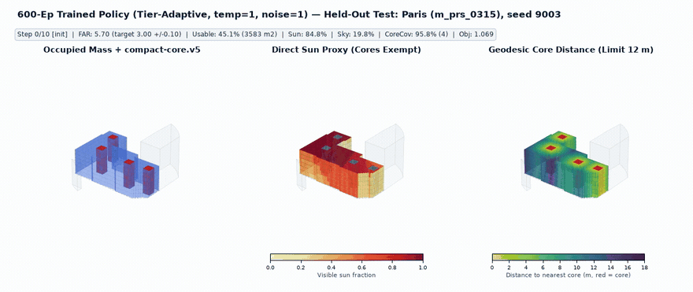
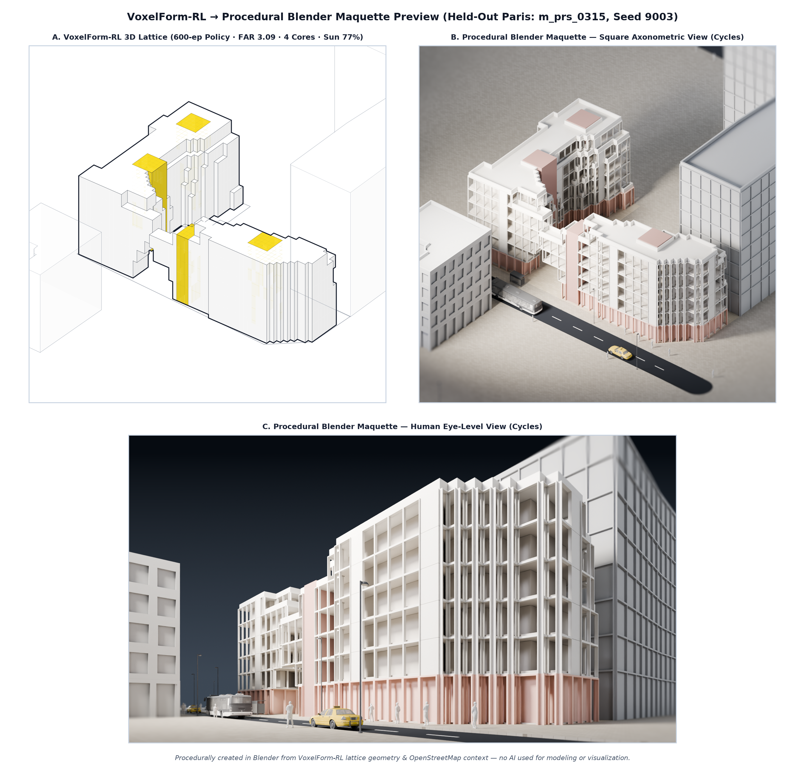
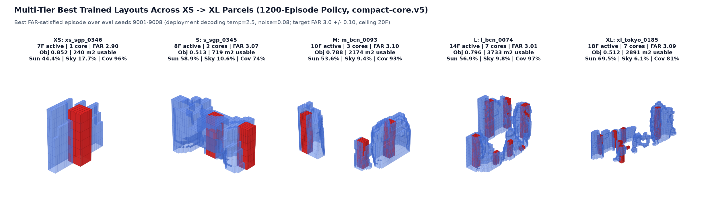
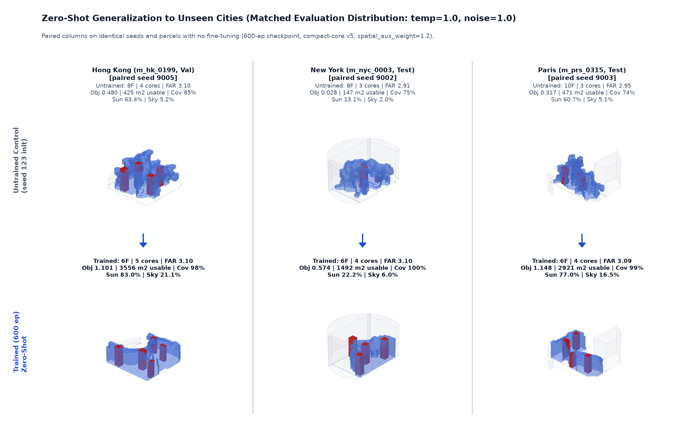
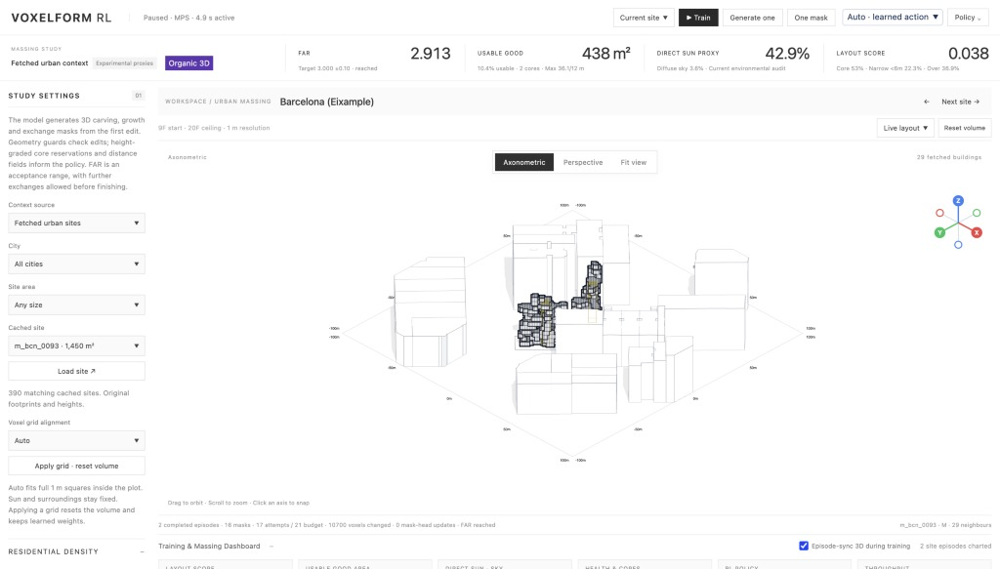
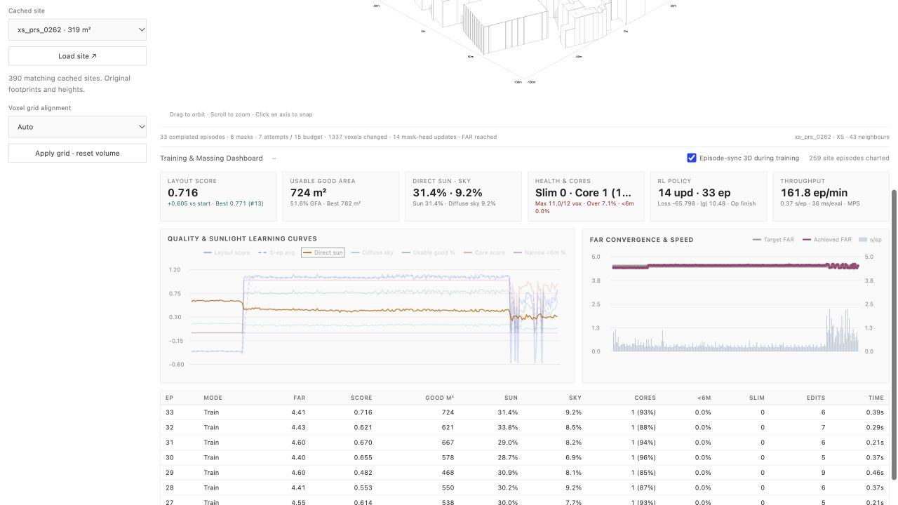
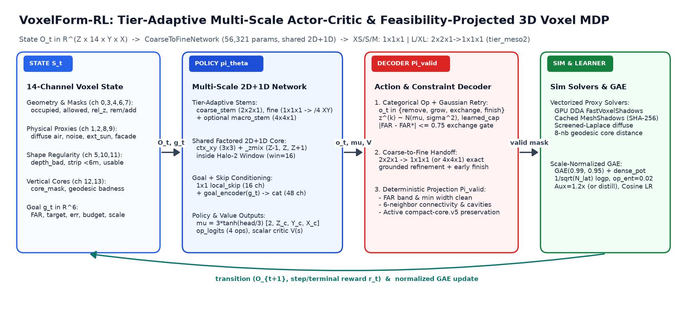
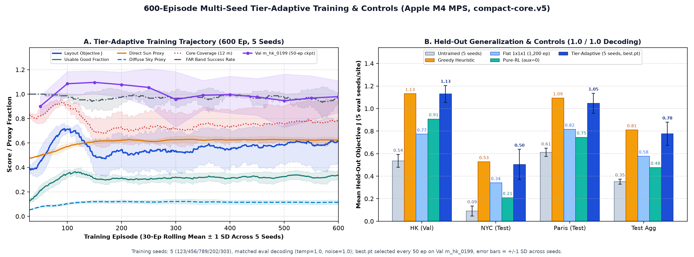
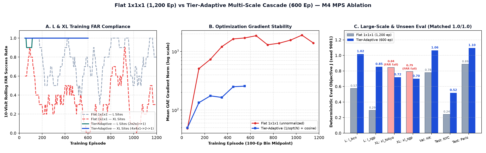
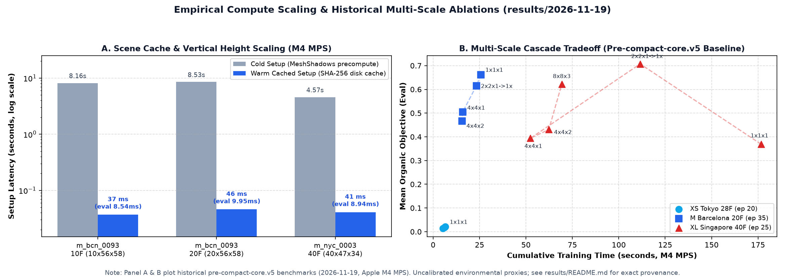

# VoxelForm-RL

[](https://github.com/guzel-hairdressers/voxelform-rl/actions/workflows/research.yml)


**Structured deep reinforcement learning for constrained 3D combinatorial optimization.**

> **Architectural / Urban Design Overview:** Looking for a non-ML introduction focused on site massing, FAR targets, daylight/sky access, and vertical core layouts? Read [**README_ARCHITECTURE.md**](README_ARCHITECTURE.md).

VoxelForm-RL is a PyTorch research codebase studying **correlated, high-dimensional 3D spatial actions under hard geometric, topological, and accessibility constraints**. Starting from an initial discrete voxel lattice $`M_0 \in \{0,1\}^{Z \times Y \times X}`$ clipped to a permitted spatial envelope $`A \in \{0,1\}^{Z \times Y \times X}`$, a tier-adaptive factored 2D+1D actor–critic sequentially carves, grows, and redistributes volumetric elements over a finite edit horizon while targeting a prescribed volumetric density band (`FAR* ± ε`) and optimizing multiple uncalibrated spatial exposure and accessibility proxies.

Urban building massing provides the concrete constraint structure, proxy physics, and 3D inspection UI; **multi-scale hierarchical representation, correlated Gaussian latent action spaces, feasibility projection, path-normalized credit assignment, and vertical compute scaling** are the primary Machine Learning objects of study.

---

## Visual Overview

### Sequential 3D Editing Trajectory on Held-Out Paris (`600`-Episode Tier-Adaptive Policy)



*Zero-shot rollout of the **600-episode tier-adaptive shared policy** (`runs/real-aux-tier-600ep`, `seed=123`, `compact-core.v5`, target `FAR = 3.00 ± 0.10`, `spatial_aux_weight=1.2`, cosine LR `1.2e-3 → 2.0e-4`) on unseen **Paris (`m_prs_0315`, eval seed `9003`, matched decoding `temp=1.0, noise=1.0`)**: over 10 sculpting steps from `FAR 5.70` down to `FAR 3.10`, objective reaches `Obj 1.169` with `69.9%` (`3,013 m²`) usable floor area, `78.0%` `directSunProxy`, `15.9%` `diffuseFacadeProxy`, and `99.2%` core coverage across `4` continuous crimson cores. **Left:** translucent occupied voxels (`1 m × 1 m × 3 m`) with embedded vertical core shafts. **Middle:** exposed-face `directSunProxy` solar visibility (core faces excluded from daylight averaging while casting shadows). **Right:** 8-neighbor geodesic floor-plate travel distance to nearest core without corner cutting. Full clip: [docs/media/episode-rollout.mp4](docs/media/episode-rollout.mp4).*

### Procedural Blender Architectural Maquette (`m_prs_0315`, Zero-AI Pipeline)



*Procedurally created in Blender from VoxelForm-RL lattice output + OpenStreetMap (`m_prs_0315`, `seed=9003`) — no AI used for modeling or visualization.*

### Cross-Scale Trained Showcase (`XS` → `XL`) & Zero-Shot Unseen City Transfer



*Selected FAR-satisfied evaluation rollouts per training plot-size tier from the **600-episode tier-adaptive shared policy** (`XS/S/M`: direct `1×1×1`; `L`: `2×2×1 → 1×1×1`; `XL`: `4×4×1 → 2×2×1 → 1×1×1`; `target_far=3.0 ± 0.10`, 20F ceiling, `compact-core.v5`, matched decoding `temp=1.0, noise=1.0`), spanning `xs_tokyo_0133` (`6F`, `0.497` obj, `100%` core coverage), `m_tokyo_0135` (`7F`, `1.082` obj, `2,259 m²` usable, `96%` coverage), `l_bcn_0074` (`1.025` obj, `4,803 m²` usable, `100%` coverage), and `xl_tokyo_0185` (`0.738` obj, `10` cores, `96%` coverage).*



*Zero-shot generalization on unseen held-out cities under **matched evaluation decoding (`temp=1.0, noise=1.0`)**: identical seeds (`9005`, `9002`, `9003`) compare untrained seed-123 initialization (top) against the 600-episode tier-adaptive trained checkpoint (bottom).*

<details>
<summary>Local Web UI Screenshots (<code>main.py</code>)</summary>

| 3D Volumetric State Inspector (local `main.py`) | Live Training Dashboard (local `main.py`) |
|---|---|
|  |  |

*Static captures of the optional local interactive workspace started via `uv run --frozen python main.py`. Left: `m_prs_0315` inspection with surrounding context geometry derived from [OpenStreetMap contributors](https://www.openstreetmap.org/copyright). Right: live episode monitoring keeping `directSunProxy` and `diffuseFacadeProxy` distinct.*

</details>

---

## Problem Formulation: Constrained 3D Volumetric MDP

We model sequential 3D editing as a finite-horizon Markov Decision Process $`(\mathcal{S}, \mathcal{A}, \mathcal{T}, R, \gamma)`$ over a metric lattice with voxel dimensions `1 m × 1 m × 3 m`:

### 1. State Space & 14-Channel Observation Tensor

At decision step `t`, state $`s_t = (O_t, g_t)`$ consists of a dense voxel observation tensor $`O_t \in \mathbb{R}^{Z_c \times 14 \times Y_c \times X_c}`$ (at the active stage resolution) paired with a normalized goal vector $`g_t \in \mathbb{R}^5`$ in `UnifiedLearner` or $`g_t \in \mathbb{R}^6`$ in `CoarseToFineLearner` (`[far, target_far, far_error, remaining_budget_frac, spent_budget_frac, scale_feature]`):

| Channels | Group | Description (`environment.py`, `unified.py`) |
|---|---|---|
| `0, 3, 4` | Lattice Geometry | Binary occupancy $`M_t`$, permitted 3D envelope $`A`$, normalized floor elevation $`z / Z`$ |
| `6, 7` | Action Eligibility | Boundary exterior-air removal weights (`remove_eligible`), 3D growth mask (`add_eligible`) |
| `1, 2, 8, 9` | Physical Proxies | Screened-Laplace diffuse sky air field, acoustic line prior (synthetic only), cached external solar ray potential, exposed facade diffuse access |
| `5, 10, 11` | Shape Regularity | Planar room-depth excess penalty (`depth_badness`), `< 6 m` narrow-strip detector beyond 2 m stubs (`long_narrow6`), usable interior depth mask |
| `12, 13` | Vertical Cores | Active `compact-core.v5` core mask $`C_t \cap M_t`$, same-floor 8-neighbor geodesic core-distance badness (limit `12 m` default) |

### 2. Hybrid Discrete–Continuous Action Space & Feasibility Projection

Rather than stepping over $`\mathcal{O}(Z \cdot Y \cdot X)`$ per-voxel Bernoulli variables independently, an action $`a_t`$ couples a high-level categorical edit operation with correlated coarse Gaussian spatial fields:

```math
o_t \sim \pi_\theta(o \mid s_t) \in \{\text{remove},\ \text{grow},\ \text{exchange},\ \text{finish}\}, \qquad z_t^{(k)} \sim \mathcal{N}\left(\mu_\theta(s_t),\ \mathrm{diag}(\sigma_\theta^2)\right)
```

**1. Correlated Decoding:** Sampled coarse fields $`z_t^{(k)} \in \mathbb{R}^{|\mathcal{C}_t| \times \lceil Z/2 \rceil \times \lceil Y/4 \rceil \times \lceil X/4 \rceil}`$ are trilinearly upsampled, smoothed via exact separable 1D (`Z`) + 2D (`Y, X`) Gaussian convolutions (avoiding MPS `Conv3d` host stalls), and ranked inside eligible edit frontiers with area budgets scaled to the target FAR band.

**2. Augmented Retry Accounting & Scale-Normalized Gradients:** When geometric projection rejects a candidate draw (up to `retries = 8`), both `UnifiedLearner` and `CoarseToFineLearner` record **all consumed Gaussian draws** (rejected + accepted) on the full coarse lattice without spatial eligibility masking, keeping score-function accounting unbiased over the augmented retry trajectory. Rather than equaling the exact Gaussian density, `CoarseToFineLearner` scales each retry block by $`1 / \sqrt{N_{\text{lat}}^{(t)}}`$ across the stage latent grid size to form the scale-normalized policy-gradient surrogate $`\tilde{\ell}_\theta(a_t \mid s_t)`$ in the A2C/GAE actor objective so `XS` and `XL` updates maintain comparable gradient magnitude:

```math
\tilde{\ell}_\theta(a_t \mid s_t) = \log \pi_\theta(o_t \mid s_t) + \sum_{k=1}^{K_t} \frac{1}{\sqrt{N_{\text{lat}}^{(t)}}} \log \mathcal{N}\left(z_t^{(k)} ; \mu_\theta(s_t), \sigma_\theta^2\right), \qquad \mathcal{L}_{\text{PG}}(\theta) = -\hat{\mathbb{E}}_t\!\left[\tilde{\ell}_\theta(a_t \mid s_t)\, \hat{A}_t\right]
```

**3. Deterministic Feasibility Projection** ($`\Pi_{\text{valid}}`$): Committed edits must satisfy the FAR band or move strictly toward it, maintain 6-neighbor solid connectivity and exterior-air cavity validity, enforce `k = 3 m` separable morphological floor width on plots `≥ 400 m²`, and preserve active `compact-core.v5` ground-to-roof shafts. Core placement uses a deterministic height-graded heuristic (`solve_cores`) over compact metric plans ([docs/CORE_LAYOUTS.md](docs/CORE_LAYOUTS.md)). Because $`\Pi_{\text{valid}}`$ and `solve_cores` embed strong domain priors, the policy acts within a **constrained hybrid decoder** rather than an unconstrained end-to-end generator.

### 3. Objective Decomposition & Policy Optimization

The shared live/headless scalar objective (`voxelform/objectives.py`) intentionally keeps directional sunlight (`sun`) and sky diffusion (`diff`) **separate**:

```math
\begin{aligned}
J(M_t) =\;& 0.65\,u_{\text{good}} + 0.55\,\bar{s}_{\text{sun}} + 0.45\,\bar{s}_{\text{diff}} + 0.10\,r_{\text{roof}} + 0.20\,s_{\text{core}} \\
& - 0.20\,\bar{d}_{\text{deep}} - 0.55\,f_{<6\text{m}} - 0.08\,\bar{\eta}_{\text{noise}} - 0.45\,f_{\text{uncov}} - 0.35\,\bar{b}_{\text{core}}
\end{aligned}
```

where $`s_{\text{core}} = \max(0, (1 - f_{\text{uncov}})(1 - 0.5\,\bar{b}_{\text{core}}))`$. Step rewards add $`0.50\,\Delta s_{\text{core}}`$ (plus a small `-0.005` hold penalty when FAR is already satisfied); terminal rewards scale $`5\cdot(J(M_T) - P_{\text{FAR}})`$ where $`P_{\text{FAR}} = 0`$ inside the band and penalizes remaining relative volume error otherwise.

Training runs synchronous actor–critic with GAE (`γ = 0.99`, `λ = 0.95`, rollout horizon `16`), Huber value regression (`0.5×`), operation entropy regularization (`0.005×`), gradient norm clipping (`≤ 2.0`), and Adam (`lr = 1.2e-3`, optional cosine annealing to `2.0e-4` via `lr_schedule = "cosine"`, `wd = 1e-4`). An optional heuristic physics-shaped dense spatial auxiliary objective is isolated via `spatial_aux_weight` (`0.0` in [configs/research-real.json](configs/research-real.json); `1.2` ablation in [configs/research-real-aux.json](configs/research-real-aux.json) and [configs/research-real-aux-tier-600ep.json](configs/research-real-aux-tier-600ep.json)).

---

## Neural Architecture (`CoarseToFineNetwork`, 56,321 Parameters)



Instead of memory-bound full-resolution 3D convolutions across arbitrary building heights $`Z \in [8, 60]`$ or flat single-scale decoding on huge blocks, `CoarseToFineNetwork` (`voxelform/coarse_to_fine.py`) extends the `Organic3DNetwork` `48,125`-parameter factored 2D+1D core (`voxelform/unified.py`) with lightweight multi-scale stems and an exact **halo-2 sliding vertical window**:

- **Tier-Adaptive Entry Stems:** Routes parcels by metric area (`tier_cascade_blocks`): `XS / S / M` (`< 2,500 m²`) run directly at `1×1×1` via the strided `4×` fine stem; `L` (`2,500–3,799 m²`) runs `2×2×1 → 1×1×1` via `coarse_stem`; `XL` (`≥ 3,800 m²`) runs `4×4×1 → 2×2×1 → 1×1×1` via `macro_stem → coarse_stem → fine stem`, preserving exact `2:1` / `4:1` grounded refinement handoffs between stages.
- **Shared Factored 2D+1D Residual Mixing (`_zmix`):** Applies planar `3×3` convolutions (`ctx_xy1`, `ctx_xy2`) followed by shift-and-add `Z`-neighbor projections (`Z-1, Z, Z+1`) inside overlapping windows (`win=16` floors, `halo=2`), keeping peak activation memory independent of maximum storey count while sharing inductive bias across all spatial scales.
- **FiLM-Style Additive Goal & Local Skip Conditioning:** Combines exact floor-mean/max global pooling with `goal_encoder(g_t)` and a pooled `1×1` `local_skip`, outputting bounded coarse latent means $`\mu_\theta = 3\tanh(\text{head}/3)`$, categorical operation logits, and scalar critic value $`V_\phi(s_t)`$.

---

## Reproducible Experiment Protocol & Empirical Benchmarks

The `vf-research` runner (`tools/research.py`, `voxelform/experiment.py`) enforces clean ML evaluation hygiene ([docs/EXPERIMENT_PROTOCOL.md](docs/EXPERIMENT_PROTOCOL.md)):

- **Strict Split & Leakage Guards:** `configs/research-real.json` trains across 10 balanced XS–XL plots (Barcelona, Tokyo, Singapore), validates on Hong Kong (`m_hk_0199`), and tests on held-out New York and Paris (`m_nyc_0003`, `m_prs_0315`), rejecting overlapping Haversine context circles across splits.
- **Controlled Baselines & Honest Accounting:** Evaluates untrained controls and fixed-budget final checkpoints on shared evaluation seeds (isolating evaluation RNG state), retains failed-FAR episodes in every mean, and computes `meanReferenceQuality` using a standardized `10 m / 12 m` `compact-core.v5` referee so core-on/off and travel-limit ablations remain comparable.
- **Full Provenance & Exact CPU Resume:** Each run archives `config.json`, `manifest.json` (git SHA, source SHA-256s, hardware/packages), `source.tar.gz` (including dirty diffs), `scenes.json`, and atomic optimizer+RNG checkpoints with strict hash verification on `--resume`.

### 600-Episode 5-Seed Tier-Adaptive Training (50-Ep Validation Checkpointing) & Controls



Trained for **600 episodes** (`443.5–945.3 s` per seed on Apple M4 MPS, `250–368` synchronous GAE updates, cosine LR `1.2e-3 → 2.0e-4`, `checkpoint_interval = 50`, [configs/research-real-aux-tier-600ep.json](configs/research-real-aux-tier-600ep.json)) across **5 model seeds (`123, 456, 789, 202, 303`)** rotating uniformly over 10 XS–XL training sites. Every `50` episodes, a snapshot is saved and evaluated on held-out **Hong Kong (`m_hk_0199`)** validation (`best.pt` selected strictly on `(farSuccessRate, meanQuality)` without touching test sites). Evaluated under matched decoding (`temp=1.0, noise=1.0`, `5` eval seeds/site, all FAR failures retained) against four controls:

1. **Untrained Control (5 seeds):** Untrained initialization baseline ([results/real-aux-tier-600ep-mps-2026-11-21.json](results/real-aux-tier-600ep-mps-2026-11-21.json)).
2. **Flat `1×1×1` (1,200 ep, seed `123`):** Fine-only baseline without coarse-to-fine stages ([results/real-aux-1200ep-mps-2026-11-21.json](results/real-aux-1200ep-mps-2026-11-21.json)).
3. **Pure-RL Ablation (`spatial_aux_weight = 0.0`, 600 ep, seed `123`):** Identical cascade trained solely from episode-end scalar GAE return ([results/real-tier-600ep-mps-2026-11-21.json](results/real-tier-600ep-mps-2026-11-21.json)).
4. **Greedy Physics-Heuristic (`0` learned parameters):** Deterministic non-learned baseline selecting feasible frontier edits using the same `compute_spatial_desirability` heuristic and projector $\Pi_{\text{valid}}$ ([results/greedy-heuristic-tier-mps-2026-11-21.json](results/greedy-heuristic-tier-mps-2026-11-21.json)).

| Method (`temp=1.0 / noise=1.0`) | Val `m_hk_0199` ($J$ / FAR / Sun / Sky) | Test `m_nyc_0003` ($J$) | Test `m_prs_0315` ($J$) | **Test Aggregate** ($J$ / FAR / Usable m² / Sun / Sky) |
|---|---:|---:|---:|---:|
| **Untrained Control** (5 seeds) | `0.536 ± 0.056` / `1.00` / `60.8%` / `6.2%` | `0.090 ± 0.045` | `0.612 ± 0.037` | `0.351 ± 0.022` / `1.00` / `507.5` / `38.7%` / `3.9%` |
| **Flat `1×1×1` (`1,200` ep)** (seed `123`) | `0.773` / `1.00` / `64.5%` / `12.5%` | `0.341` | `0.816` | `0.578` / `1.00` / `1,722.0` / `47.1%` / `8.3%` |
| **Tier Pure-RL (`λ_aux=0.0`)** (seed `123`) | `0.907` / `1.00` / `66.4%` / `16.9%` | `0.209` | `0.745` | `0.477` / `1.00` / `1,040.4` / `37.5%` / `5.8%` |
| **Tier + Aux, Final Ep 600 (`latest.pt`, 5 seeds)** | `0.979 ± 0.131` / `0.88` / **`82.4%`** / `21.4%` | `0.288 ± 0.477` | `1.004 ± 0.230` | `0.646 ± 0.352` / `1.00` / `1,920.9` / **`52.3%`** / **`11.2%`** |
| **Tier + Aux, 50-Ep Val (`best.pt`, 5 seeds)** | `1.129 ± 0.075` / **`1.00`** / `81.6%` / **`22.2%`** | `0.504 ± 0.133` | `1.047 ± 0.089` | `0.776 ± 0.103` / **`1.00`** / `2,097.3` / `51.3%` / `10.8%` |
| ↳ *Top Val-Selected Seeds (`303` / `789` / `456`)* | `1.064` / **`1.257`** / `1.094` | **`0.656`** / `0.522` / `0.548` | `1.070` / **`1.158`** / `1.075` | **`0.863`** / **`0.840`** / **`0.811`** (at `FAR 1.00`) |
| **Greedy Physics-Heuristic** (`0` params) | **`1.131`** / `1.00` / `76.5%` / `18.3%` | `0.527` | `1.093` | **`0.810`** / `1.00` / **`2,190.5`** / `48.4%` / `9.5%` |

**Key Empirical Takeaways:**
- **50-Episode Validation Checkpointing Prevents Overfitting & Policy Collapse (`0.776 ± 0.103` vs `0.646 ± 0.352`):** All 5 seeds peak early-to-mid run (`bestValidationEpisodes = [100, 400, 250, 200, 150]`). Without validation selection, `seed-303` collapses by episode `600` (`0.40` Val FAR; `-0.560` NYC Test; `0.023` Test Agg), whereas `seed-303`'s validation-selected episode-`150` `best.pt` achieves **`0.863`** Test (`0.656` NYC, `1.070` Paris). Overall, `best.pt` recovers `1.00` Val/Test FAR compliance across all 5 seeds (`0.88` -> `1.00` Val FAR) and cuts Test inter-seed SD by **3.4×** (`0.103` vs `0.352`).
- **Spatial Auxiliary Credit Assignment Is Essential (`0.776 ± 0.103` vs `0.477`):** Without dense per-voxel auxiliary advantage (`λ_aux = 0.0`), the agent hits FAR `1.00` on every site and scores `0.907` on Hong Kong, but stalls on deep-canyon New York (`0.209`, `143.8 m²` usable) vs `0.504 ± 0.133` (`1,548.8 m²` usable; up to `0.656` on `seed-303`) with `λ_aux = 1.2`.
- **RL vs. Deterministic Physics Heuristic — Near-Parity on Scalar $J$ with Higher Daylight Exposure:** Three of five validation-selected seeds (`303`: `0.863`, `789`: `0.840`, `456`: `0.811`) outperform the deterministic zero-parameter Greedy Physics-Heuristic (`0.810`), and 5-seed `best.pt` achieves higher mean direct sunlight (**`81.6%` vs `76.5%`** Val; **`51.3%` vs `48.4%`** Test) and diffuse sky exposure (**`22.2%` vs `18.3%`** Val; **`10.8%` vs `9.5%`** Test). On 5-seed mean scalar $J$, `seed-202` (`0.605` Test / `0.291` NYC) leaves the aggregate (`0.776 ± 0.103` Test / `1.129 ± 0.075` Val) just behind the deterministic greedy heuristic (`0.810` Test / `1.131` Val).

### Flat `1×1×1` (1,200 Ep) vs. Tier-Adaptive Multi-Scale (600 Ep) Ablation



In a matched `seed=123` head-to-head on Apple M4 MPS, switching large blocks from flat `1×1×1` updates to progressive coarse-to-fine sculpting (`L`: `2×2×1 → 1×1×1`; `XL`: `4×4×1 → 2×2×1 → 1×1×1`), normalizing per-draw Gaussian log-probabilities by $`1/\sqrt{N_{\text{lat}}}`$, and annealing the learning rate cuts training wall-clock time by **6.3×** (`416.9 s` vs `2,625.6 s`) and fixes `XL` training divergence:

| Comparison Metric (Apple M4 MPS, `seed=123`) | Flat `1×1×1` (`1,200` ep) | Tier-Adaptive Multi-Scale (`600` ep) |
|---|---:|---:|
| Overall Training FAR Compliance (last 500 ep / ep `101–600`) | `0.70 – 0.89` | **`1.00`** across all 10 `XS–XL` sites |
| `L`-Tier Training Quality (`l_bcn_0074` / `l_sgp_0369`, last 20 visits) | `0.4995` / `0.575*` | **`1.0085`** / **`0.9659`** (`FAR 1.00`) |
| `XL`-Tier Training FAR Compliance (late half: `xl_tokyo_0185` / `xl_sgp_0386`) | `0.52` / `0.17` | **`1.00`** / **`1.00`** |
| Mean GAE Gradient Norm across 100-Ep Bins | `48.6 → 1,900.2` (diverging) | **`49.8 → 256.0`** (`7.4×` lower peak) |
| Deterministic Eval (`seed=9001`): `XL` Sites (`xl_tokyo_0185` / `xl_sgp_0386`) | `FAR 5.69` / `5.79` (**FAIL**) | **`FAR 3.10`** (`0.7176`) / **`FAR 3.10`** (`0.6985`) |
| Deterministic Eval (`seed=9001`): `L` Sites (`l_bcn_0074` / `l_sgp_0369`) | `0.5747` / `0.2923` | **`1.0164`** / **`0.8523`** |

**Note:** *The `1,200`-ep vs `600`-ep comparison above reflects a single `seed=123` head-to-head (`spatial_aux_weight=1.2`); across the 5-seed validation-checkpointed `600`-ep benchmark (`123, 456, 789, 202, 303`), `best.pt` retains `FAR = 1.00` across all 5 seeds (`0.776 ± 0.103` Test vs `0.646 ± 0.352` at episode 600). Training-window `l_sgp_0369` `last10` was `0.575` in flat `1×1×1`, and flat `1,200`-ep had its own untrained control (`0.568` Val / `0.279` Test) due to distinct entry stems.*

### Infrastructure Verification & Compute Scaling



| Measurement Scope | Dataset / Artifact | Key Observed Metrics | Interpretation Boundary |
|---|---|---|---|
| **Pipeline, Determinism & Core Integrals** (`compact-core.v5`, CPU + MPS) | [results/ml-infrastructure-final-check-2026-11-20.json](results/ml-infrastructure-final-check-2026-11-20.json) | 2-seed CPU exact resume (bitwise weight/trace equality); `farSuccessRate = 1.0`; `meanQuality = 0.593 ± 0.045`; `meanDirectSun = 0.293 ± 0.003`; `meanDiffuseSky = 0.177 ± 0.011`; native MPS 3-ep smoke (`mpsFallback=false`) | Software, gradient, and exact-resume pipeline validation on synthetic fixtures; small budgets do not test learned policy quality or convergence |
| **Scene Cache & Vertical Scaling** (`coarse_2d1d_v3`, M4 MPS) | [results/scalable-height-speedup-2026-11-19.json](results/scalable-height-speedup-2026-11-19.json) | Cold→Warm SHA-256 cache setup: `8.16s→37ms` (`10F`), `8.53s→46ms` (`20F`), `4.57s→41ms` (`40F`); warm single-step eval stays `8.54–9.95 ms` across `10F→40F` | Historical pre-`compact-core.v5` compute benchmark; isolates scene cache and GPU/CPU field solver scaling |
| **Multi-Scale Cascade Tradeoff** (M4 MPS, 20–35 ep) | [results/multiscale-ablation-2026-11-19.json](results/multiscale-ablation-2026-11-19.json) | On `xl_sgp_40F` (ep 25), `4×4×2`/`8×8×3` cascades cut wall-clock time vs `1×1×1` (`69.3s` vs `176.6s`) while `c2f_2x2x1` reached `0.707` objective (`40%` FAR success vs `100%` for `8×8×3` at `0.623`) | Historical pre-`compact-core.v5` exploratory ablation on single sites; full multi-seed study under `voxelform.research.v1` remains open |

Retained raw benchmark summaries, pipeline verification checks, and solver probes are indexed in [results/README.md](results/README.md).

---

## Quickstart & Reproducibility

Requires Python 3.11–3.13, [uv](https://docs.astral.sh/uv/), and Node.js 22 (for JS viewer tests). Zero external datasets are needed for the self-contained CPU smoke experiment and unit tests.

### 1. Install & Run Self-Contained CPU Smoke Experiment

```sh
uv sync --frozen --extra dev --python 3.12

# Train two seeds (123, 456) on synthetic geometry with strict CPU determinism
uv run --frozen vf-research train \
  --config configs/research-smoke.json \
  --output runs/smoke-check

# Evaluate fixed-budget checkpoint on held-out synthetic split
uv run --frozen vf-research evaluate \
  --checkpoint runs/smoke-check/seed-123/latest.pt \
  --split test \
  --output runs/smoke-check/eval-test.json
```

### 2. Multi-Tier Urban Context Training (Standalone Bundled Dataset)

All 13 benchmark OSM-derived parcels and surrounding building context (`XS–XL` train, Hong Kong validation, NYC & Paris test) are **bundled standalone** in [`data/urban_context/public/`](data/urban_context/public/) (overrideable via `$VOXELFORM_CONTEXT_ROOT` or a sibling `Module-Lab` checkout):

```sh
# Deterministic non-learned greedy physics-heuristic baseline
uv run --frozen vf-research heuristic \
  --config configs/research-real-aux-tier-600ep.json \
  --output runs/greedy-heuristic.json

# Tier-adaptive pure-RL ablation (spatial_aux_weight = 0.0, seed 123)
uv run --frozen vf-research train \
  --config configs/research-real-tier-600ep.json \
  --output runs/real-tier-600ep

# Multi-seed tier-adaptive 600-episode sweep (seeds 123, 456, 789, 202, 303; 50-ep Val -> best.pt)
uv run --frozen vf-research train \
  --config configs/research-real-aux-tier-600ep.json \
  --output runs/real-aux-tier-600ep

# Flat 1x1x1 1,200-episode baseline on Apple MPS
uv run --frozen vf-research train \
  --config configs/research-real-aux-1200ep.json \
  --output runs/real-aux-1200ep
```

### 3. Live 3D Inspector & Test Suite

```sh
# Launch interactive inspector at http://127.0.0.1:8011 (core plans at /core-plans)
uv run --frozen python main.py

# Run complete verification suite (205 Python tests, 11 JS geometry tests, repo-wide lint)
uv run --frozen --extra dev python -m unittest discover -s tests
node --check public/*.js
node --test tests/*.test.mjs
uv run --frozen --extra dev ruff check .
```

---

## Repository Structure

```text
VoxelForm-RL/
├── voxelform/
│   ├── environment.py       # 3D voxel lattice, FAR band, step dynamics & metrics
│   ├── unified.py           # Organic3DNetwork (48,125 params), GAE learner & projection Pi_valid
│   ├── coarse_to_fine.py    # Multi-scale cascade actor-critic (CoarseToFineNetwork)
│   ├── objectives.py        # Shared live/headless reward & proxy decomposition
│   ├── cores.py             # Geodesic core distance, badness & greedy core solver
│   ├── core_plans.py        # Canonical compact-core.v5 parametric footprints & SVG export
│   ├── fields.py            # Screened-Laplace diffuse sky, facade depth & acoustic priors
│   ├── shadows.py           # FastVoxelShadows (GPU DDA) & MeshShadows (cached raycaster)
│   ├── patch_policy.py      # Separable Gaussian field smoothing & frontier patch allocation
│   ├── experiment.py        # Config schema, atomic RNG checkpoints, source archival & resume
│   └── layout_archive.py    # SQLite episode ledger & top-five distinct layout archive
├── data/urban_context/      # Standalone bundled 13-site XS–XL OSM parcel & context dataset
├── configs/                 # Reproducible experiment specs (smoke, real, real-tier, tier-600ep)
├── tools/                   # CLI entrypoints: research.py, render_core_plans.py, media & benchmarks
├── tests/                   # 205 Python unittest specs + 11 Node geometry/syntax tests
├── docs/                    # Protocol, Model Card, Data Card, Core Layouts & media figures
├── results/                 # Retained raw JSON benchmarks, core checks & solver probes
├── public/                  # Three.js inspector UI & standalone /core-plans viewer
├── unified_server.py        # FastAPI inspection server (port 8011)
├── README_ARCHITECTURE.md   # Architectural & urban massing overview (non-ML reader guide)
└── .github/workflows/       # CPU CI: unit tests, JS checks, ruff lint & smoke train
```

---

## Methodological Limitations & Open Research Directions

- **Uncalibrated Physical Proxies:** `directSunProxy`, `diffuseFacadeProxy`, acoustic `noisePrior`, planar depth, and 8-neighbor geodesic core distance are research surrogate signals — not calibrated daylight simulations, acoustic models, structural analyses, or building-code/egress compliance verifications ([docs/DATA_CARD.md](docs/DATA_CARD.md), [docs/MODEL_CARD.md](docs/MODEL_CARD.md)).
- **Hand-Designed Structural & Heuristic Priors:** Morphological opening (`k=3`), long-strip filtering (`<6 m`), connectivity/cavity checks, deterministic greedy core placement, and the `compute_spatial_desirability` auxiliary field inject strong inductive bias; even with 50-episode validation checkpointing stabilizing `FAR = 1.00`, residual inter-seed variance in deep canyons (`0.504 ± 0.133` on unseen NYC across 5 seeds) leaves surpassing the deterministic greedy heuristic (`0.810` Test $J$) consistently across all random initializations an open ML challenge.
- **Open Multi-Objective & Throughput Work:** Pareto trade-off learning across conflicting proxy objectives (e.g., goal-conditioned weight preferences, multi-head vector critics, or Lagrangian FAR constraints) and batched multi-environment rollout vectorization remain active next experiments rather than settled results.

---

## Documentation & Citation

- [Architectural & Urban Design Overview](README_ARCHITECTURE.md)
- [Experiment Protocol](docs/EXPERIMENT_PROTOCOL.md) · [Model Card](docs/MODEL_CARD.md) · [Data & Simulator Card](docs/DATA_CARD.md)
- [Compact Core Geometry (`compact-core.v5`)](docs/CORE_LAYOUTS.md) · [Results Index](results/README.md) · [Contributing Guidelines](CONTRIBUTING.md) · [Citation Metadata](CITATION.cff)

*Repository code licensing remains an explicit owner decision; vendored Three.js and OpenStreetMap context attributions are preserved under their original terms.*

```bibtex
@software{voxelform_rl_2026,
  title   = {VoxelForm-RL: Structured Reinforcement Learning for Constrained 3D Voxel Editing},
  author  = {Ruslan F},
  year    = {2026},
  version = {0.2.0},
  url     = {https://github.com/guzel-hairdressers/voxelform-rl}
}
```
