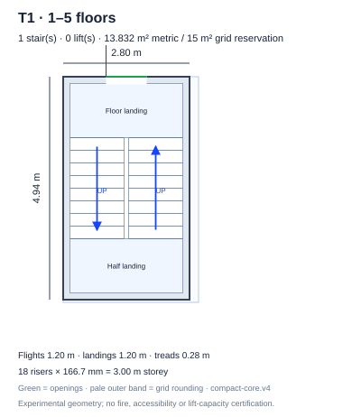
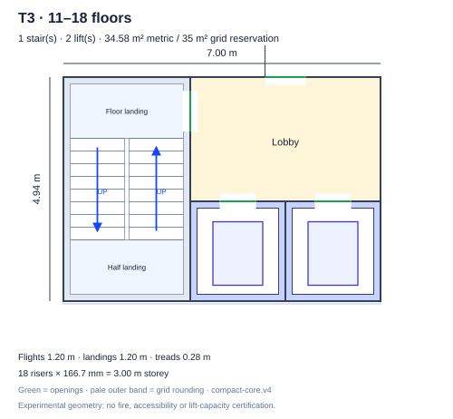
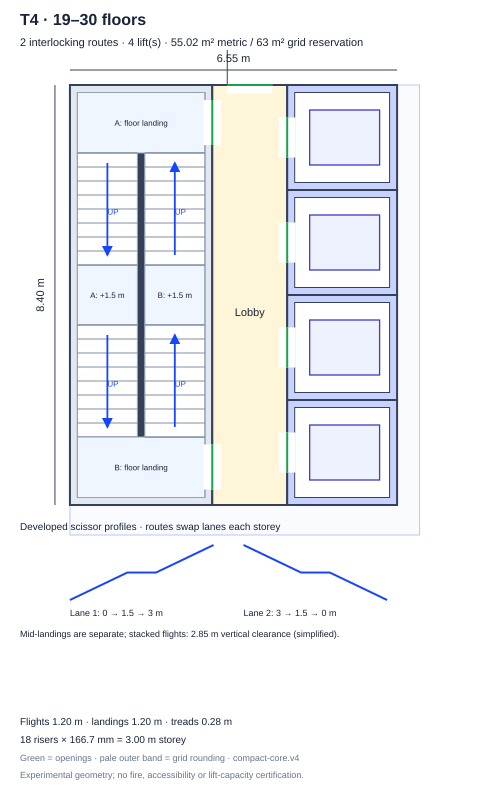

# VoxelForm-RL — Architectural & Urban Massing Overview

> **Machine Learning & Technical Overview:** Looking for the MDP formulation, factored 2D+1D network architecture, GAE optimization, and empirical benchmark protocol? Read [**README.md**](README.md).

**Early-stage 3D urban massing exploration on real city parcels under density (`FAR`), daylight, floor-plate depth, and vertical core constraints.**

VoxelForm-RL treats a city block on a **`1 m × 1 m × 3 m` storey voxel grid** (`3 m` floor-to-floor height) surrounded by neighboring OpenStreetMap building massing. Starting from an initial extruded podium on a real parcel in **Barcelona, Tokyo, Singapore, Hong Kong, New York, or Paris**, a trained spatial agent carves courtyards, steps terraces, shifts mass vertically, and maintains continuous **ground-to-roof structural and circulation cores** to hit a prescribed **Floor Area Ratio (`FAR = 3.00 ± 0.10`)** while balancing daylight exposure, sky openness, and habitable floor-plate depth.

---

## Massing Choreography in Motion (Unseen Paris)


*Zero-shot massing sequence on held-out **Paris (`m_prs_0315`, eval seed `9003`, `target FAR = 3.00 ± 0.10`)** without retraining on Paris. Over `10` volumetric edits starting from `FAR 5.70`, the policy carves an interior light court and steps upper massing down to `FAR 3.10`, increasing usable well-daylit floor area from `3,583 m²` (`45.1%`) to `3,013 m²` (`69.9%` of total mass), reaching **`78.0%` direct sun access**, **`15.9%` diffuse sky access**, and **`99.2%` core coverage** within a `12 m` travel limit across `4` continuous crimson cores. Full video: [docs/media/episode-rollout.mp4](docs/media/episode-rollout.mp4).*

Each frame exposes three synchronous architectural analyses:
1. **Left — Occupied Mass + Vertical Cores:** Translucent interior/perimeter floor plates (`1 m × 1 m × 3 m`) surrounding opaque crimson vertical core shafts running unbroken from ground to top roof floor.
2. **Middle — Direct Sun Proxy (Cores Exempt):** Facade and roof exposure against local sun vectors and surrounding OpenStreetMap context blocks; solid core faces are excluded from daylight averaging while still casting realistic shadows.
3. **Right — Geodesic Core Travel Distance:** Exact same-floor walking path distance (`8-neighbor` floor-plate routing without cutting corners) from every occupied workspace cell to the nearest shaft (green/yellow = within `12 m` target limit; dark purple = beyond `12 m`).

---

## Cross-Scale Massing Showcase (`XS` Infill to `XL` Urban Blocks)

Real plots span nearly `40×` in footprint area (`155 m²` Tokyo infill to `5,737 m²` Singapore superblocks). Instead of sculpting giant `XL` parcels solely brick-by-brick at `1 m`, the system adapts its spatial planning granularity to plot area:

- **`XS / S / M` (`< 2,500 m²`):** Direct fine sculpting (`1×1×1`, `1 m × 1 m × 3 m`).
- **`L` (`2,500–3,799 m²`):** Two-stage massing — blocks out courtyards and primary wings on a **`2×2×1` (`2 m × 2 m × 3 m`)** grid before refining edges at **`1 m`**.
- **`XL` (`≥ 3,800 m²`):** Three-stage cascade — establishes overall urban block massing at **`4×4×1` (`4 m`)**, shapes wings at **`2×2×1` (`2 m`)**, and finishes articulation at **`1 m`**.


*Best FAR-compliant designs across parcel scales from the **600-episode shared policy** (`target FAR = 3.0 ± 0.10`, `20F` envelope ceiling): ranging from compact `7F` single-core infill (`xs_sgp_0346`, `97%` coverage) and chamfered wedges (`s_sgp_0345`), to dual courtyard wings (`m_bcn_0093`, `2,327 m²` usable), Eixample perimeter courtyards (`l_bcn_0074`, `4,803 m²` usable, `6` cores, `100%` coverage), and multi-core `XL` urban bars (`xl_tokyo_0185`, `10` cores, `96%` coverage).*

---

## Generalization to Unseen Cities

To verify that learned daylight-massing strategies transfer beyond the training cities (`Barcelona`, `Tokyo`, `Singapore`), the model is evaluated zero-shot on held-out blocks in **Hong Kong (`m_hk_0199`)**, **New York (`m_nyc_0003`)**, and **Paris (`m_prs_0315`)** surrounded by dense real context geometry:


*Zero-shot city transfer on identical random seeds (`9005`, `9002`, `9003`) comparing unoptimized random initialization (**top**) against the trained policy (**bottom**). Note how the trained forms open light courts, pull back upper plates from tall neighbors, and align floor-plate depths around vertical cores.*

| Unseen City Site | Initial / Untrained Usable Area | **Trained Usable Daylit Area** | `directSunProxy` (Initial → **Trained**) | `diffuseFacadeProxy` (Initial → **Trained**) | Core Coverage (`≤ 12 m`) | FAR Target Hit |
|---|---:|---:|---:|---:|---:|---:|
| **Hong Kong** `m_hk_0199` | `1,048.8 m²` (`15.2%`) | **`3,552.8 m²` (`50.8%`)** | `61.2% →` **`78.8%`** | `6.1% →` **`18.8%`** | `79.2% →` **`96.5%`** | `100%` |
| **New York** `m_nyc_0003` | `106.8 m²` (`2.6%`) | **`1,544.6 m²` (`36.1%`)** | `13.5% →` **`22.1%`** | `1.6% →` **`5.8%`** | `78.5% →` **`96.9%`** | `100%` |
| **Paris** `m_prs_0315` | `846.8 m²` (`20.4%`) | **`2,727.8 m²` (`63.4%`)** | `63.0% →` **`77.8%`** | `6.2% →` **`16.3%`** | `88.7% →` **`96.6%`** | `100%` |

*(5 evaluation seeds per site under matched decoding; direct sun exposure and diffuse sky visibility are always reported as separate proxies rather than blended into a single light number.)*

---

## Built-In Spatial, Structural & Circulation Rules

Every massing candidate is automatically checked and projected onto strict geometric rules rather than relying on penalty terms alone:

- **Parcel & Zoning Density (`FAR` Band):** Clipped strictly to the buildable lot envelope up to the configured storey ceiling (`20F` in the benchmark study; architectural engine scalable up to `60F`), terminating within `target FAR ± 0.10`.
- **Daylight & Sky Differentiation:** Separately evaluates **direct solar visibility** against context buildings and self-shadowing, and **diffuse sky access** (roof terraces, stepbacks, light-court openings).
- **Habitable Floor-Plate Depth & Sliver Filtering:** Scores usable interior floor area within habitable daylight depth while penalizing deep unlit floor centers, enforcing a **minimum `3 m` structural/room width** on plots `≥ 400 m²` and suppressing `< 6 m` leftover thin slivers (`> 2 m` projections).
- **Structural Continuity & Void Hygiene:** Guarantees `6-neighbor` volumetric connectivity anchored on the ground floor and prevents trapped interior air cavities inside the solid envelope.
- **Height-Graded Vertical Cores (`compact-core.v5`):** Automatically positions and sizes continuous ground-to-roof core footprints on the `1 m` planning grid according to served building height ([docs/CORE_LAYOUTS.md](docs/CORE_LAYOUTS.md)):

| Building Height Band | Stairs | Lifts | Metric Core Enclosure | Grid Reservation | Example Blueprint (`docs/core-plans/`) |
|---|---:|---:|---|---:|---|
| **1–5 storeys** (`T1`) | 1 dogleg | 0 | `2.80 × 4.94 m` (`13.83 m²`) | `3 × 5 = 15 m²` | [T1 Plan (SVG)](docs/core-plans/T1.svg) |
| **6–10 storeys** (`T2`) | 1 dogleg | 1 | `4.90 × 4.94 m` (`24.21 m²`) | `5 × 5 = 25 m²` | [T2 Plan (SVG)](docs/core-plans/T2.svg) |
| **11–18 storeys** (`T3`) | 1 dogleg | 2 | `7.00 × 4.94 m` (`34.58 m²`) | `7 × 5 = 35 m²` | [T3 Plan (SVG)](docs/core-plans/T3.svg) |
| **19–30 storeys** (`T4`) | 2 scissor routes | 4 | `6.55 × 8.40 m` (`55.02 m²`) | `7 × 9 = 63 m²` | [T4 Plan (SVG)](docs/core-plans/T4.svg) |
| **31–60 storeys** (`T5`) | 2 scissor routes | 4 | `6.55 × 8.40 m` (`55.02 m²`) | `7 × 9 = 63 m²` | [T5 Plan (SVG)](docs/core-plans/T5.svg) |

| Low/Mid-Rise Walkup (`T1`, 1–5F) | Mid/High-Rise Twin Lift (`T3`, 11–18F) | High-Rise Scissor Bank (`T4`, 19–30F) |
|---|---|---|
|  |  |  |

---

## Interactive 3D Studio Workspace (`main.py`)

When launched locally, VoxelForm-RL provides a browser-based 3D workspace (`http://127.0.0.1:8011` and `/core-plans`) for inspecting real city sites, tuning FAR and travel limits (`12 m` default), sculpting interactively, and browsing the top-5 highest-scoring distinct massing variants saved per site:

```sh
# Start the local interactive 3D workspace (requires Python + uv)
uv run --frozen python main.py
```

| 3D Volumetric State Inspector (local `main.py`) | Live Training & Proxy Diagnostics (local `main.py`) |
|---|---|
|  |  |

*Static screenshots captured from the optional local web workspace running via `main.py`. Left: `m_prs_0315` massing with surrounding context derived from [OpenStreetMap contributors](https://www.openstreetmap.org/copyright). Right: live inspection keeping `directSunProxy` and `diffuseFacadeProxy` metrics distinct.*

---

## Methodological Scope & Caveats for Practice

VoxelForm-RL is an **early-stage massing & computational design research prototype**, not an engineering sign-off tool:

- **Uncalibrated Environmental Proxies:** `directSunProxy` and `diffuseFacadeProxy` are fast GPU/grid surrogate signals without weather-file (EPW) luminance, seasonal insolation hours, material reflectance, or interior window-to-wall ratios; they must not substitute for Radiance/IES daylight or LEED/EN 17037 compliance simulations.
- **Schematic Core & Egress Templates:** The `compact-core.v5` plans (`T1–T5`) provide dimensionally grounded `1 m` space reservations (including interlocking scissor layouts on 19–60F templates) and `8-neighbor` floor-plate travel checks, but do not verify local building codes, smoke pressurization, structural core wall thickness, MEP riser sizing, or independent protected exit certification.
- **Massing Prior vs. Detailed Design:** Structural stability beyond `6-neighbor` vertical grounding and cantilever prevention requires downstream structural analysis and architectural programming.

---

For RL formulation, loss objectives, checkpoint reproducibility, and test protocols, see [**README.md**](README.md) and [docs/CORE_LAYOUTS.md](docs/CORE_LAYOUTS.md).
