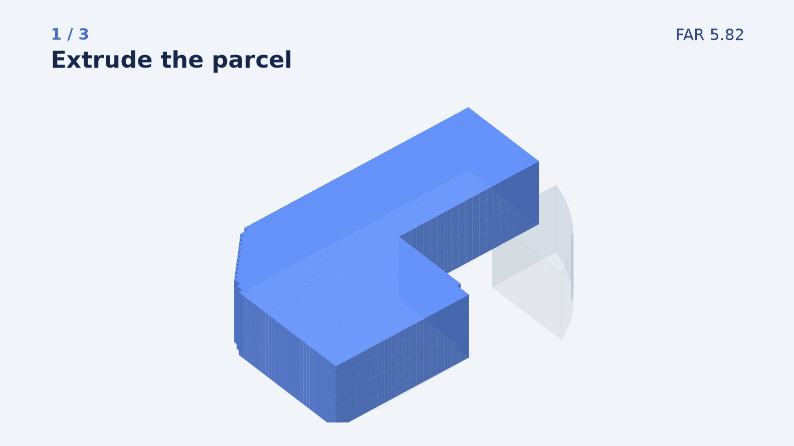
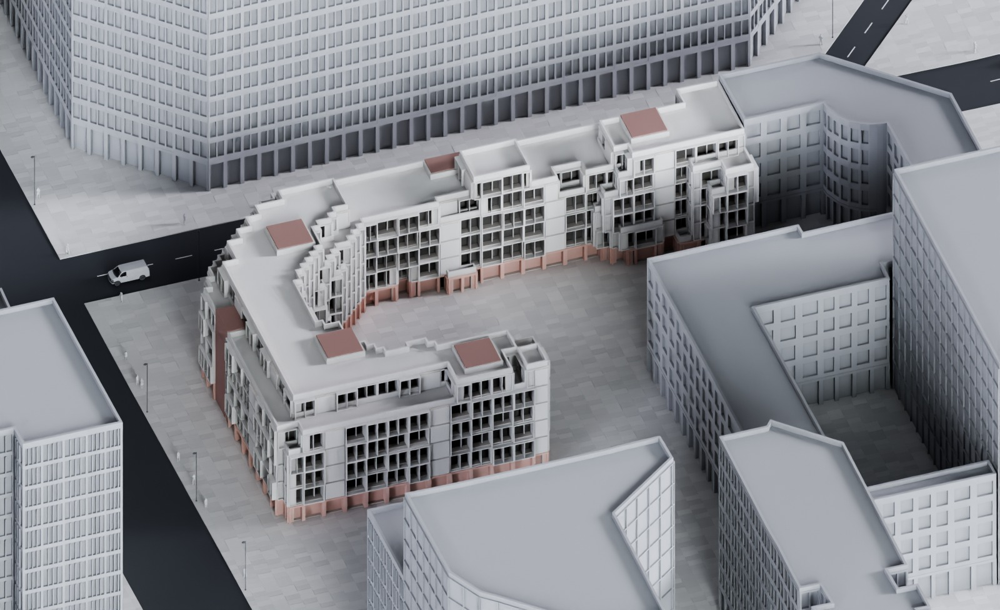
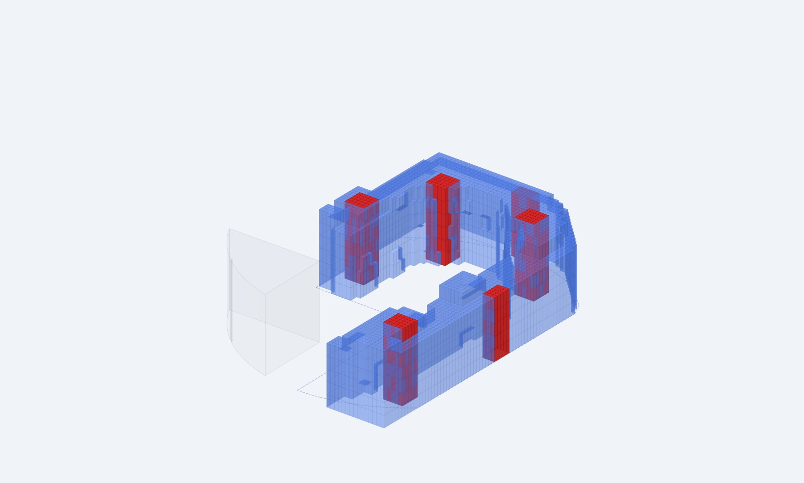
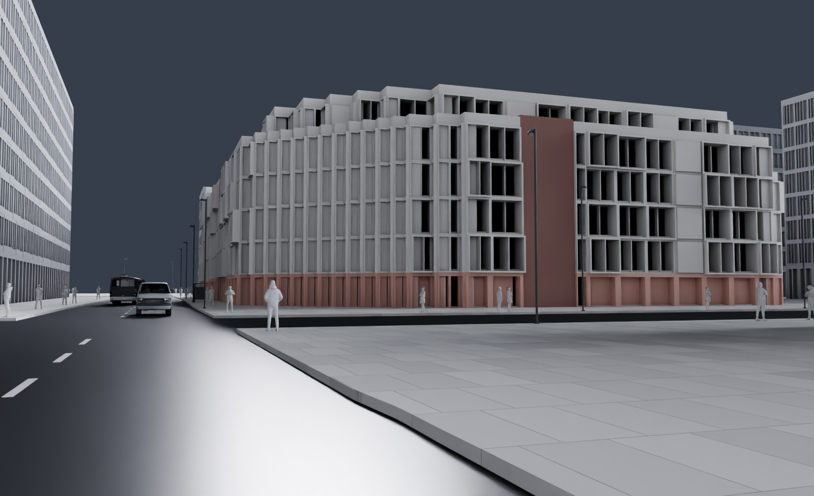
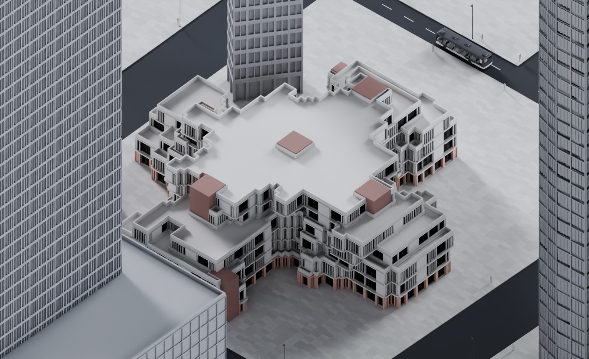
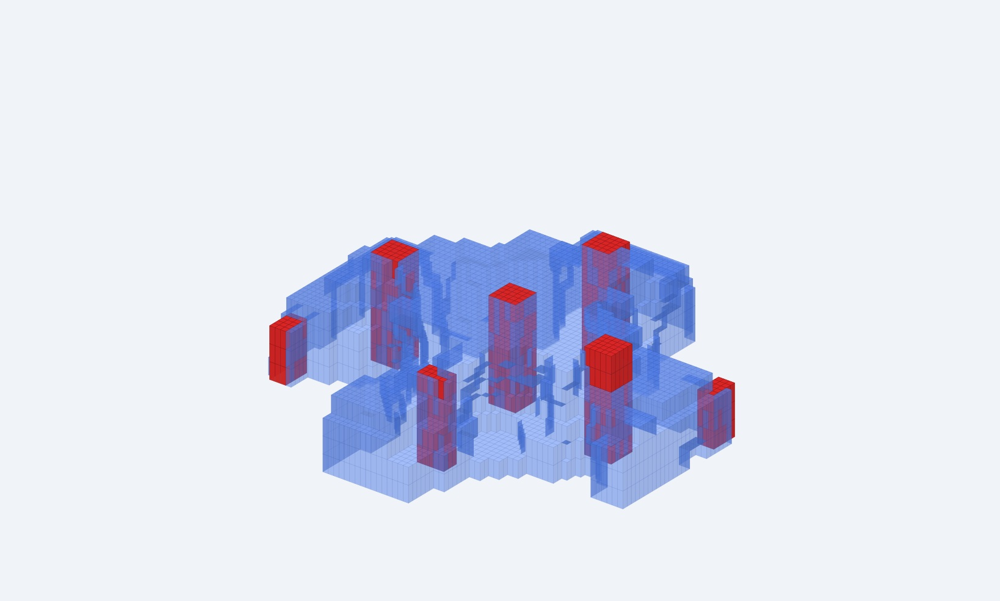
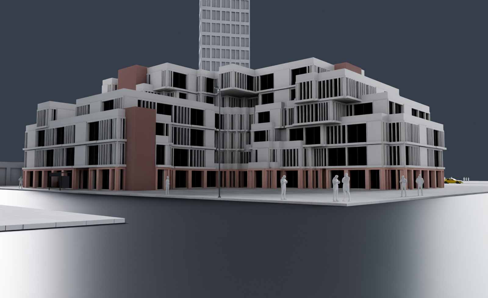

# VoxelForm-RL · Urban massing studies

**How much can a building change while keeping the same density target?** VoxelForm-RL explores this question on real parcels. It starts with an extruded volume and learns which parts to carve or grow, taking the surrounding buildings, daylight and space for circulation into account.

## Paris · Two volumes along the street

The street frontage breaks into two volumes at a floor area ratio of **3.09**. The voxel view shows the proposed mass and the space reserved for stairs and lifts in red. The aerial and street views translate that same geometry into a procedural architectural model.

## Barcelona · Carving an Eixample courtyard

Starting from the parcel extrusion, the learned policy carved an open court while keeping the street edges. The courtyard emerged through successive edits without a preset court shape. The share of floor area within **8 m of a façade** rose from **62% to 100%** as FAR fell from **5.82 to 2.90**.

| Voxel axonometric | Street-level maquette |
| --- | --- |
|  |  |

## Singapore · Stepping a larger block

On a **3,845 m²** parcel, the policy produced stepped wings around several openings at a floor area ratio of **2.90**. The aerial view shows where the wings pull apart. The street view gives a sense of how their different heights meet the ground.

| Voxel axonometric | Street-level maquette |
| --- | --- |
|  |  |

## How it works

- **Set the site and density.** A parcel and its surroundings define the working envelope. Floor area ratio (FAR) is gross floor area divided by parcel area. The target for these studies is **3.0**, with an accepted range of **2.9–3.1**.
- **Edit and evaluate.** A reinforcement learning policy proposes where to remove or add groups of voxels. Geometry checks limit the edits. The evaluation looks at depth to the nearest façade on each storey, direct sun exposure and diffuse sky access as separate measures. Stair and lift cores are reserved according to the height they serve. [Core plans](docs/CORE_LAYOUTS.md)
- **Translate the model.** A Blender script turns the voxel geometry into floor slabs, façades and core volumes. The same exporter can apply a curtain wall, deep window bays or ribbon glazing with louvers. [Geometry export](tools/export_blender_site.py) · [Camera and render script](tools/blender_render_showcase.py)

The showcases are selected examples of generated forms. The project evaluates the learned policy against a rule-based baseline across multiple sites. The lighting and circulation measures are early design proxies. Detailed daylight, structural and egress studies would be separate work. [ML overview](README.md) · [Experiment results](results/README.md)

<!-- Barcelona l_bcn_0074 (evaluation seed 9008) and Singapore l_sgp_0379 (evaluation seed 9205)
use the guided L/XL run's local validation-selected episode-450 checkpoint (training seed 4215,
SHA-256 a8d49b006675347b84a3a419a66bcc099aae4ea4eb7c2607756c58806e392423).
The axos and Blender exports use identical occupancy and core masks and the bundled urban contexts. -->

## Explore a plot

Run `uv run --frozen python main.py` and open [the local 3D workspace](http://127.0.0.1:8011). Choose a catalog site or open **Context source → Module Lab custom plots** to load a saved plot from a local Module Lab checkout.

Surrounding building and street data © [OpenStreetMap contributors](https://www.openstreetmap.org/copyright).
