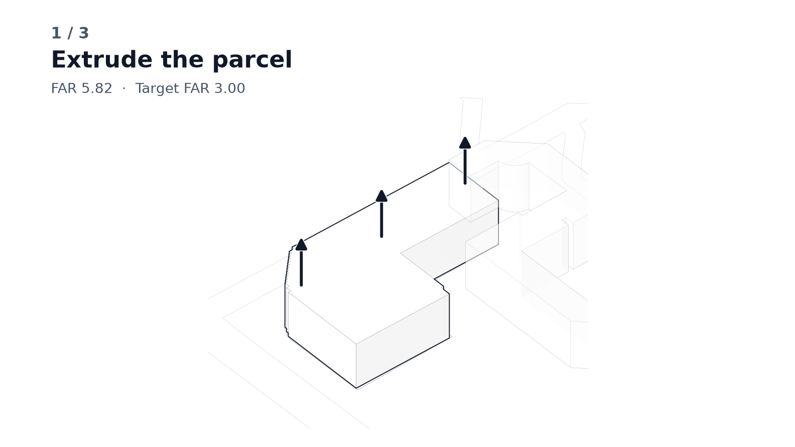
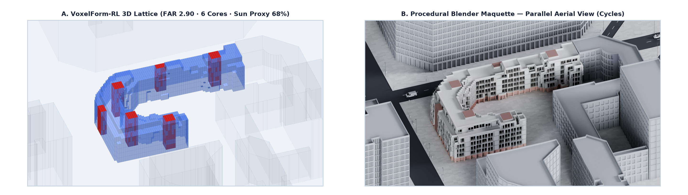
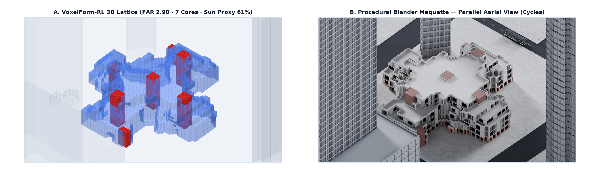
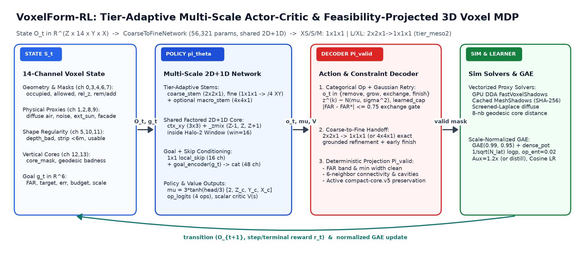
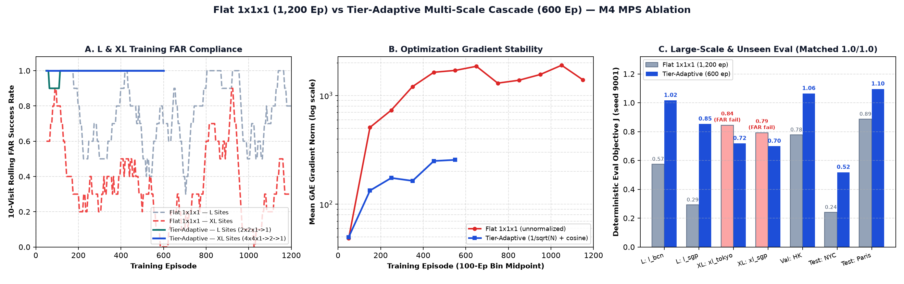

# VoxelForm-RL · Density, daylight, and the urban block

*Paris, one edit sequence. Left shows the mass and reserved cores. Center shows sampled direct sun. Right shows walking distance to the closest core.*

## How the form is carved

The sequence shows three moments in a massing study. An initial extrusion establishes the envelope, a carve opens a court, and successive edits refine the perimeter towards the target floor area ratio (FAR).

## Paris · A break in the street frontage

The Paris study divides the street frontage into two volumes at **FAR 3.09**. The gap makes the two masses readable from the street. The procedural maquette shows how the model’s core reservations and floor plates carry through to the façade.

## Barcelona · Opening the middle of the block

The Eixample study keeps mass along the street edges and opens the middle of the block. Red identifies the space reserved for stairs and lifts. In the maquette, the envelope becomes recessed window bays and a ground-floor arcade.

As FAR fell from **5.82 to 2.90**, the share of floor area within **8 m of a façade** rose from **62% to 100%**. The direct-sun and diffuse-sky scores fell over the same edits. The court shortened floor-plate depth, while exposure to light still depended on orientation, enclosure, and neighboring buildings.

## Singapore · Stepped wings on a larger site

The **3,845 m²** parcel reaches **FAR 2.90** with a broad upper plate and stepped wings. The axonometrics show how the setbacks change across the block. Continuous slabs and vertical louvers give those steps a legible façade rhythm.

## From the voxel grid to the architectural model

A floor area target leaves the shape of a building open. VoxelForm-RL uses reinforcement learning to test how courts, stepped wings, and breaks in street frontage emerge from successive edits that account for density, daylight, and circulation.

In the Barcelona and Singapore plates, the voxel diagram and the maquette share the same orthographic projection, crop, and voxel state. The left panel isolates the envelope and cores against simplified context. The Blender exporter adds slabs, parapets, a façade system, and streetscape detail. [Geometry export](tools/export_blender_site.py) · [Comparison plate renderer](tools/render_matched_showcase.py)

Each voxel is **1 × 1 × 3 m** and contributes **1 m²** of gross floor area. FAR divides the total by the original parcel area. The policy proposes where to remove, add, or exchange groups of voxels. A geometric decoder checks those patches, and larger parcels pass through a coarse stage before finer edits. Each committed edit updates the occupancy used in the next evaluation. [Experiment protocol](docs/EXPERIMENT_PROTOCOL.md)

The evaluation keeps three design questions distinct. **Plan depth** measures horizontal distance to the nearest exterior wall on the same storey. **Direct sun and diffuse sky access** are separate exposure estimates that account for self-shading and neighbors. **Circulation** is represented by height-graded stair and lift reservations and a same-floor walking-distance check. These are schematic design measures. Detailed daylight, structure, and egress require separate studies. [Core layout library](docs/CORE_LAYOUTS.md)

## Architectural precedents

- **Daylight as Form.** Daniel Koehler’s lab-eds catalogue reads courts, stepped sections, and other light-shaping devices across precedents in the dense city. It provides a typological reference for the Barcelona court and the Singapore terraces. [Lab-eds project](https://lab-eds.org/work/daylight-as-form)
- **Maison Partino.** Rasa Navasaityte used reinforcement learning to assemble prefabricated housing components and evaluate the voids between them. It provides a precedent for treating the space created by sequential operations as part of the design objective. [Lab-eds project](https://lab-eds.org/work/maison-partino)

## What transfers across sites

Selected layouts across five parcel sizes show how the same policy adapts to narrow infill, perimeter wings, and larger blocks with several circulation cores.

The upper and lower rows compare untrained and trained rollouts on the same sites and evaluation seeds. In the later five-seed L/XL benchmark, a greedy geometry heuristic led both XL sites and the overall mean. Guided RL led on one Singapore L site. [L/XL benchmark](results/l-xl-600ep-mps-2026-11-22.md)

### Research figures

| Training and validation | Single- and multiscale editing | Compute and scene caching |
| --- | --- | --- |
|  |  |  |

Open a figure at full size for metrics and legends. The historical single- and multiscale runs also differed in budget and training settings. [Technical README](README.md) · [Results index](results/README.md)

## Explore a plot

| 3D workspace | Training diagnostics |
| --- | --- |
|  |  |

Run `uv run --frozen python main.py` and open [the local 3D workspace](http://127.0.0.1:8011). Choose a catalog site or open **Context source → Module Lab custom plots** to load a saved parcel from a local Module Lab checkout.

Surrounding building and street data © [OpenStreetMap contributors](https://www.openstreetmap.org/copyright).

<!-- Barcelona l_bcn_0074 (evaluation seed 9008) and Singapore l_sgp_0379 (evaluation seed 9205)
use the guided L/XL run's local validation-selected episode-450 checkpoint (training seed 4215,
SHA-256 a8d49b006675347b84a3a419a66bcc099aae4ea4eb7c2607756c58806e392423).
The two panels in each comparison use the same occupancy and core masks and the bundled urban contexts. -->
