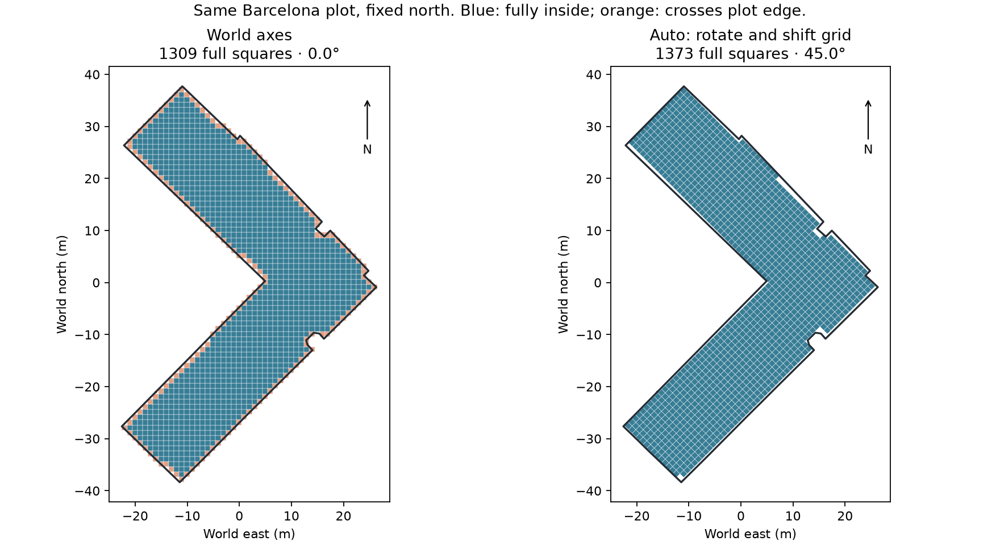
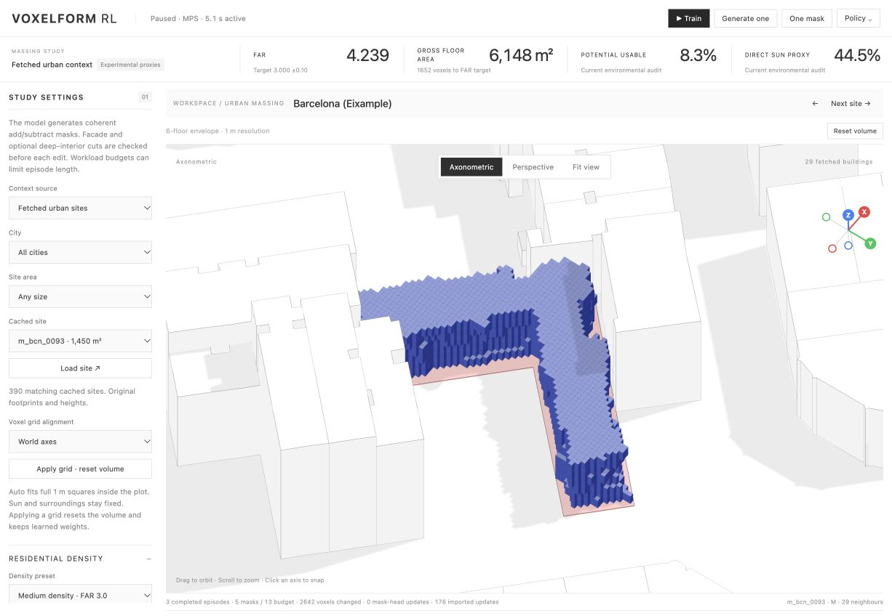
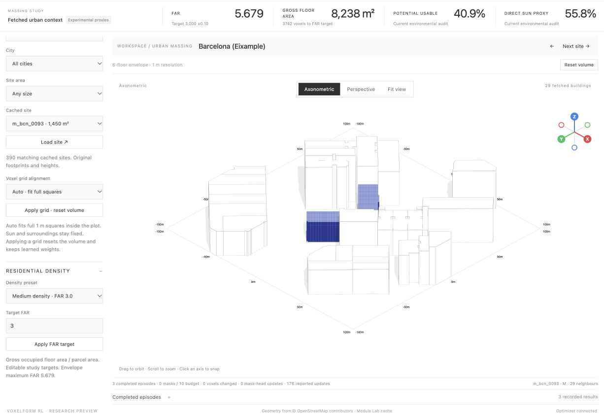

# Grid fitting, quality tests and presentation — 2026-11-09

Automatic 2D fitting improves full-square coverage on all four tested real
plots. The learning test is mixed; it does not establish a consistent quality
advantage. Independent sky rays do not validate the much larger apparent gains
in the existing usable-area proxy. Preserve that distinction.

## Shipped grid controls

Fetched plots offer world axes, both area-weighted principal axes, the longest
edge, eight longer perimeter edges, and **Auto · fit full squares**. Auto uses
the union of ground triangles (including concavities and holes), searches a
3° coarse angle sweep plus actual edges/principal direction, refines around two
best angles in 0.5° steps, and searches quarter-cell translations. It maximizes
fully contained 1 m squares, breaking ties by smaller computational grid and
then deterministic angle/offset order. This is a bounded search, not a proof of
the global optimum. Containment tolerance is 10⁻⁸ m for coincident boundaries.

Only the computational grid rotates/translates. Original parcel, neighbours,
roads, north/south and world-space sun directions stay fixed. Simulation meshes
and sun/hemisphere rays transform together; the viewer transforms back. FAR
continues to use original parcel area. Applying alignment pauses and resets the
volume, preserves model/optimizer, floor count and FAR settings, and saves the
alignment in coupled autosave. Current live mass was not changed automatically.

Auto's allowed footprint uses full squares. Manual modes deliberately retain
the previous centre-based raster for compatibility. Their allowed cell counts
therefore differ from the full-square counts below; neither count replaces
source parcel area in FAR. Auto can leave narrow boundary strips unoccupied.

| Plot | World: full squares | Longest edge: full squares | Auto: full squares | Auto angle | Fit setup |
|---|---:|---:|---:|---:|---:|
| Barcelona 0093 | 1309 | 1315 | **1373** | 45.0° | 2.63 s |
| Barcelona 0094 | 1202 | 1273 | **1281** | 42.12° | 2.73 s |
| New York 0003 | 1282 | 1290 | **1341** | 60.5° | 1.62 s |
| Paris 0315 | 1275 | 1308 | **1323** | 73.27° | 3.56 s |

This CPU preparation happens once per grid change, not each edit. All four
fitted footprints have one planar component. Full-square coverage improved
3.8–6.6% over world axes. This is geometric coverage, not a daylight result.

## Matched alignment quality study

48 untrained policy runs: four real sites × four manual orientations × three
network/sampling seeds (123, 456, 789), on MPS. Same two-layer facade/depth
eligibility, coherent masks, feedback allocator, six floors, target FAR 3±0.1.
No policy was trained for these alignment comparisons. Auto was introduced
after this study and is evaluated geometrically above, not included in these
48 policy runs.

Legacy quality normalizes some terms by grid-dependent capacities/bounding
area, so it is unsuitable for ranking rotations directly. The study retains
individual metrics and a comparison-only score:
`0.7 * usable/occupied + 0.18 * directSun + 0.12 * sunnyRoof/sourceParcelArea`.
Production reward was not changed. All successful comparisons use the same
FAR band, mostly ending close to 3.1. Failures are retained, not dropped silently.

| Plot | World usable/occupied | Longest-edge usable/occupied | World FAR successes | Longest-edge successes |
|---|---:|---:|---:|---:|
| Barcelona 0093 | 14.1% | 29.3% | 3/3 | 3/3 |
| Barcelona 0094 | 6.5% | 16.2% | 2/3 | 2/3 |
| New York 0003 | 0.3% | 4.9% | 3/3 | 3/3 |
| Paris 0315 | 22.1% | 36.6% | 3/3 | 2/3 |

Means above include successful runs only and have unequal samples. Raw results
also retain principal-axis modes (11/12 and 10/12 successes); world achieved
11/12 and longest edge 10/12. These large usable-proxy changes are **not evidence
of equivalent physical daylight improvements**. Raster perimeter changes and
the diffusion field's 0.15 usable threshold can strongly affect this measure.

## Independent diffuse sky check

Replayed seed 123, world versus longest edge, with 256 uniformly sampled lateral
facade faces and 64 upper-hemisphere directions. Cosine-weighted visibility uses
original contextual triangles and independent exact voxel DDA for self-blocking.
It does not use the diffusion field or the sampled solar path. A known empty-
context box gives exactly 1.0 sky visibility on all lateral faces.

| Plot | World sky reference | Longest edge sky reference | Approximate face-sampling SE |
|---|---:|---:|---:|
| Barcelona 0093 | 0.2264 | 0.2158 | 0.012–0.013 |
| Barcelona 0094† | 0.0963 | 0.0863 | 0.009 |
| New York 0003 | 0.0378 | 0.0419 | 0.004 |
| Paris 0315 | 0.3615 | 0.3758 | 0.017–0.018 |

† World-axis run failed FAR, so this pair is not a matched successful quality
comparison. The other differences are small compared with sampling uncertainty.
Face samples are spatially correlated; SE is descriptive, not a statistical
guarantee. No broad diffuse-sky improvement is established. This exposes why
optimizing the usable-area proxy alone would be misleading; calibrate it against
independent visibility before treating reward gains as design improvements.

## Equal-time learning with post-FAR redistribution

Two arms × two seeds, **180 active training seconds per arm/seed**, on actual
MPS, fallback disabled. Scene setup and exact immutable receiver-cache
preparation totalled 89.1 s outside those budgets. Held-out evaluations were also
outside the timer. Both arms used six initial storeys inside a ten-storey height
ceiling, two facade layers and up to four post-FAR paired removal/roof-addition
moves. Paired edits preserve the accepted FAR band and may reject rather than
invent a repair. No learned whole-storey categorical action was added.

Training: wide synthetic, irregular synthetic and Barcelona 0093. Held out:
irregular courtyard, XL 10×64×96 and Barcelona 0094. XL retains 12 sun directions;
others use eight. Synthetic scenes have 16 contextual buildings. Actual real
mesh counts/shapes, preparation timings, memory and metric vectors are in JSON.

The enhanced arm couples the nine-input actor (explicit eligibility, horizontal
depth, fixed external direct-sun potential and separate diffuse facade access)
with stronger quality reward plus depth shaping. The baseline keeps five inputs
and current reward. Extra-channel weights start at zero, giving the same initial
spatial policy. This experiment tests the bundle; it does not isolate each input.

| Arm | Seed | Train actions | Optimizer updates | Held-out FAR successes | Mean paired Δquality |
|---|---:|---:|---:|---:|---:|
| Current | 123 | 951 | 86 | 2/3 | −0.00246 |
| Current | 456 | 655 | 54 | 3/3 | −0.00039 |
| Enhanced | 123 | 604 | 58 | 3/3 | +0.00275 |
| Enhanced | 456 | 829 | 72 | 3/3 | +0.00124 |

Quality differences use only initial/final pairs that both reached FAR. All
initial runs succeeded. Current improved quality in 1/5 successful pairs;
enhanced improved in 3/6. Enhanced mean quality rose 0.001997; usable/occupied
rose 13.16→13.59%, diffuse facade proxy 0.04184→0.04540, while direct sun fell
0.40461→0.40202. These are small, conflicting changes, not convergence.

The enhanced arm performed 1433 training actions versus baseline 1606 in equal
time. Held-out accepted refinement moves totalled only 8/24 possible for enhanced
and 16/20 possible for current's successful runs; rejection/limited feasible exchange remains important.
The ten-storey ceiling establishes growth capacity, not learned towers.

Experimental checkpoints are wrapped as `voxelform.refinement-experiment.v1`
with initial/ceiling/refinement protocol metadata, keeping them separate from
the live checkpoint loader. None replaced the user's preview policy.

## Presentation and verification

The supplied mood boards guide blue interventions, white context and a soft
peach site. Solid mass now uses light blue roofs, distinct cobalt wall tones
and per-face tinted fill so even fully shadowed mass is legible. The shared
Module Lab renderer still supplies directional light/shadows and camera controls;
its code was not modified. Evaluation palettes remain separate.

Camera-facing tree sprites are supported only on fetched green polygons with
deterministic, spaced placements. They are illustrative, not surveyed trees,
and do not alter environmental evaluation. A scan of all 390 currently cached
scenes found no green meshes, so the live scene correctly has no added trees.
Placement invariants are tested; real-context tree rendering awaits such data.

126 Python tests and seven Node checks passed. Checks include full-square
containment, rotated/translated principal axes, world mesh round-trips, identical
external visibility after transform, fixed world sun directions, autosave and
weight/floor-count preservation. JavaScript syntax and whitespace checks passed.
Browser verified auto fitting on isolated port 8012, then closed/stopped it.
Main preview on 8011 remains paused with exactly 6148 cells, 176 policy updates,
five masks and original world alignment. No browser errors were observed.

Raw results: [fit](../../results/grid-fit-2026-11-09.json),
[48 alignment runs](../../results/grid-quality-2026-11-09.json),
[independent rays](../../results/grid-sky-validation-2026-11-09.json),
[timed learning](../../results/m4-training-quality-grid-study-2026-11-09.json).
Seeds, configuration and source hashes are retained in these files. No push or
commit was made; existing unrelated uncommitted work was preserved.
