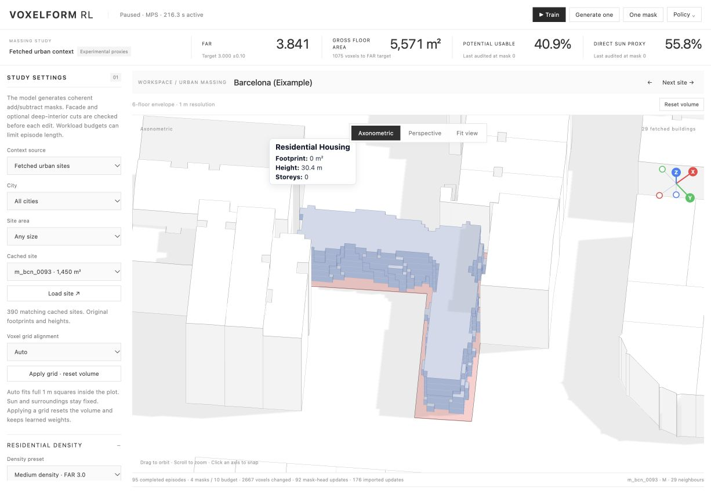

# Lighter mass, fast outlines and simplified grid — 2026-11-09

Solid display now uses pale blue roofs/walls with brighter face-tinted fill,
retaining the shared renderer's shadows. Cubes touch at their exact 1×1×3 m
dimensions instead of leaving display gaps. This removes artificial grid seams.
The shared Module Lab renderer and environmental evaluation are unchanged.

`public/voxel-contours.js` scans grid edges. Four incident occupancy values
identify convex/concave creases and diagonal contacts. Coplanar seams are omitted;
collinear edges merge into runs. Complexity is linear in grid volume; the result
is one depth-tested LineSegments batch, with no camera-dependent contour work.
It rebuilds on state revision and hides on evaluation overlays. This is boundary
crease rendering, not a screen-space silhouette algorithm. Hidden edges remain
depth-occluded by opaque surfaces. No CSG, per-cube edge objects or pixel pass.

Measured on this machine in Node, eight warmups and 30 samples:

| Input | Shape | Occupied | Merged lines | Position bytes | Median | p95 |
|---|---|---:|---:|---:|---:|---:|
| Captured preview | 6×56×58 | 7278 | 495 | 11880 | 4.00 ms | 5.32 ms |
| XL courtyard fixture | 8×64×96 | 32730 | 30 | 720 | 9.36 ms | 11.38 ms |

These time contour calculation only, not world-coordinate transformation,
GPU upload or rendering. Geometry complexity affects line count; these are not
worst-case fragmented shapes. Results are in
`results/voxel-contours-2026-11-09.json`; input capture is retained under
`results/checkpoints/contour-benchmark-input.json`.

Nine Node tests pass, including a 12-edge solid cuboid and independent exposed-
face reference comparison on 60 seeded random occupancy fields, covering holes,
concavity and diagonal contacts. Seven grid/session Python tests pass, including
fresh-session Auto default and saved orientation/weights/floors preservation.
Syntax and whitespace checks pass. Browser verified the pale solid display,
depth-overlay switching and four-option menu, with no console errors.

The grid UI now contains exactly **Auto, World, Principal 1, Longest edge**.
Fresh sessions default to Auto; saved/legacy sessions preserve alignment to avoid
changing their grid beneath saved occupancy. Legacy backend modes remain readable.

Important correction communicated to user: the experimental trainer DOES
hardcode FAR correction first and then up to four paired removal/growth actions.
The live model has NO vertical expansion phase: its six-floor initial mass fills
its six-floor ceiling, and it stops at FAR. More training cannot remove that
action-space limitation. No training-order/action changes were implemented in
this display/menu update. A future unified policy should be able to redistribute
floor area throughout an episode with height headroom and a FAR acceptance band.
The viewer's single artistic shadow must not be equated with diffuse sky access
or the independently sampled direct-sun objective.

User trained/changed mass concurrently (Auto alignment, 95 episodes, 92 direct
updates plus 176 imported, paused at 5571 cells during final browser check).
No model reset/restart/import or geometry edits were performed by this update.

