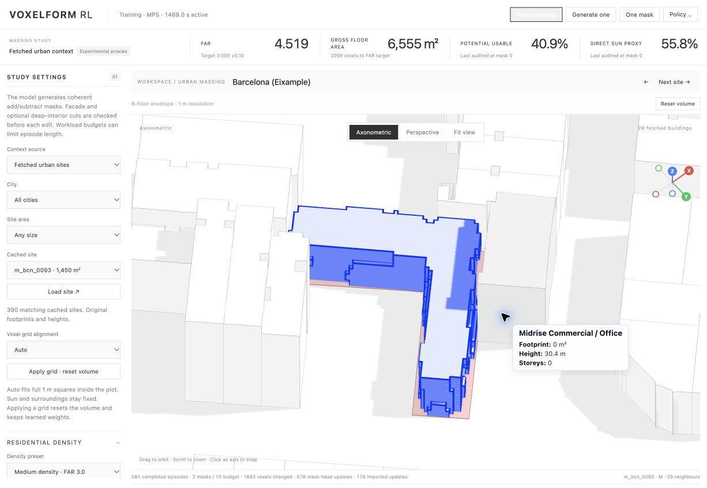

# 3 px outlines and fixed HSL blue — 2026-11-10

User reverted to surface outlines, not silhouettes. Current implementation uses
merged boundary creases, one LineSegments2 batch. World-space width is calibrated to 3 px when the mass
spans roughly 400 pixels, then stays fixed in world units: zooming out makes
the screen stroke thinner. Browser verified near/far views. Removed the silhouette
mask target, extra render pass and camera-facing filters from the live adapter.
The silhouette helper remains for historical tests, not used in the viewer.

Final palette preserves the hue (~227.90°) and saturation (100%) of #1645ff:
outline L=50% (#0033ff), darkest fill L=70% (#6685ff), lightest fill L=95%
(#e6ebff). Colours derive from the common HSL values in sRGB. The Lambert shader
retains the shared directional lighting and shadows, then maps illumination to
the requested lightness endpoints. Interpolation occurs in sRGB to retain hue
and saturation, followed by conversion to linear for normal output encoding.
No additional emissive multiplication shifts the endpoint colours. Tone mapping
is disabled on these materials. Antialiasing at edges can blend with background.

The original lower mass edges were below the parcel top and depth-occluded.
Display mass and line positions now share a small lift to parcel top +0.03 m
(at least 0.23 m). Geometry and environmental occupancy are unchanged. Other
buildings still occlude outlines normally. This does not draw hidden wireframes.

Ten existing Node checks pass; JS syntax/whitespace checks pass. Direct Three
colour conversion confirms the HSL endpoints within its conversion tolerance.
Browser shows the surface outlines, visible lower boundaries and blue fill,
with no console errors. The user continued training; no pause/reset, policy
import, server restart or mass edit was made by this update.

