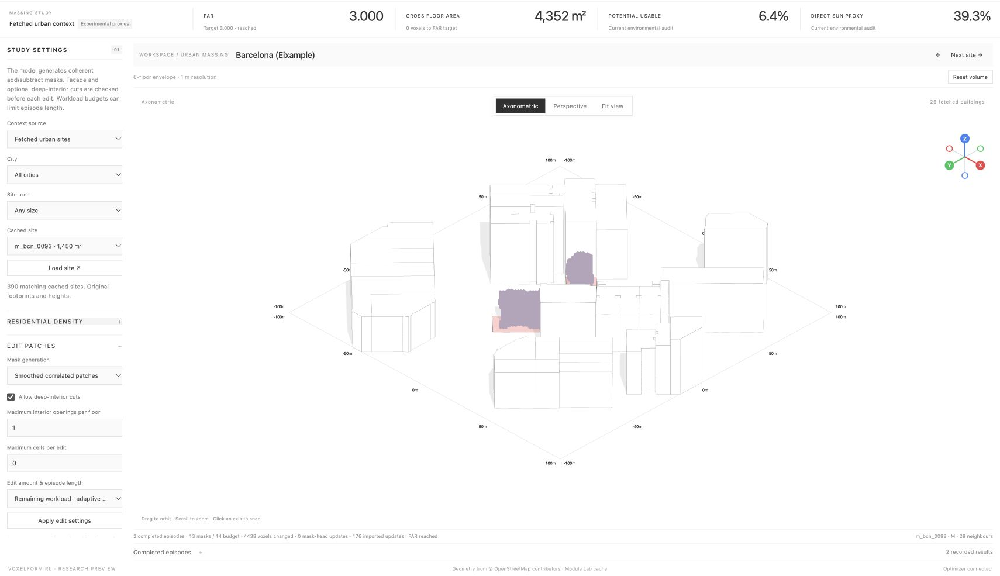
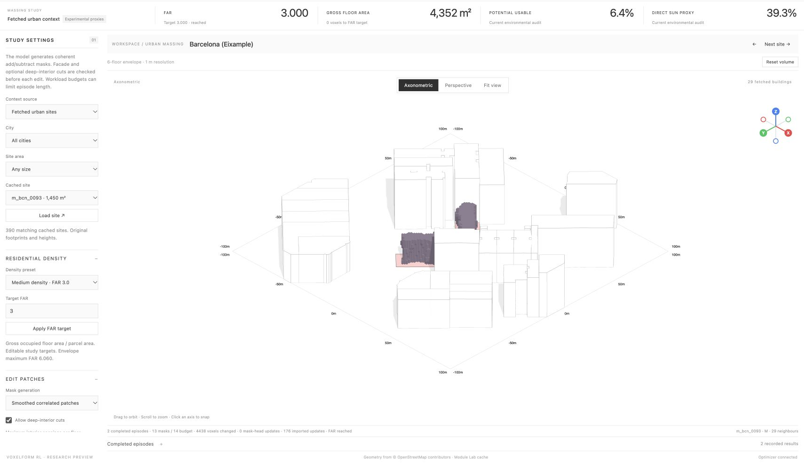

# Massing shading — 2026-11-09

The solid mass previously used MeshBasicMaterial and binary vertex colours:
all three positively sun-facing cube orientations received the same multiplier.
That made the mass read as a single flat silhouette.

The solid view now uses flat MeshLambertMaterial with the shared renderer’s
existing directional light and shadow map. It casts and receives shadows; a
small emissive fill keeps unlit faces readable without adding lights or changing
Module Lab. Evaluation layers retain unlit colours with a continuous restrained
orientation cue. This is display shading, separate from the environmental audit.

Versioned host/viewer script URLs ensure existing browser tabs load the new
material. Checked the real cached Barcelona scene in Chrome, switched to facade
depth and back to solid, and found no console errors. The preview remains paused
at 13 masks, FAR 3.0003447087. No policy, geometry or training changes were made.
JavaScript syntax, whitespace and the four viewer adapter checks pass.

