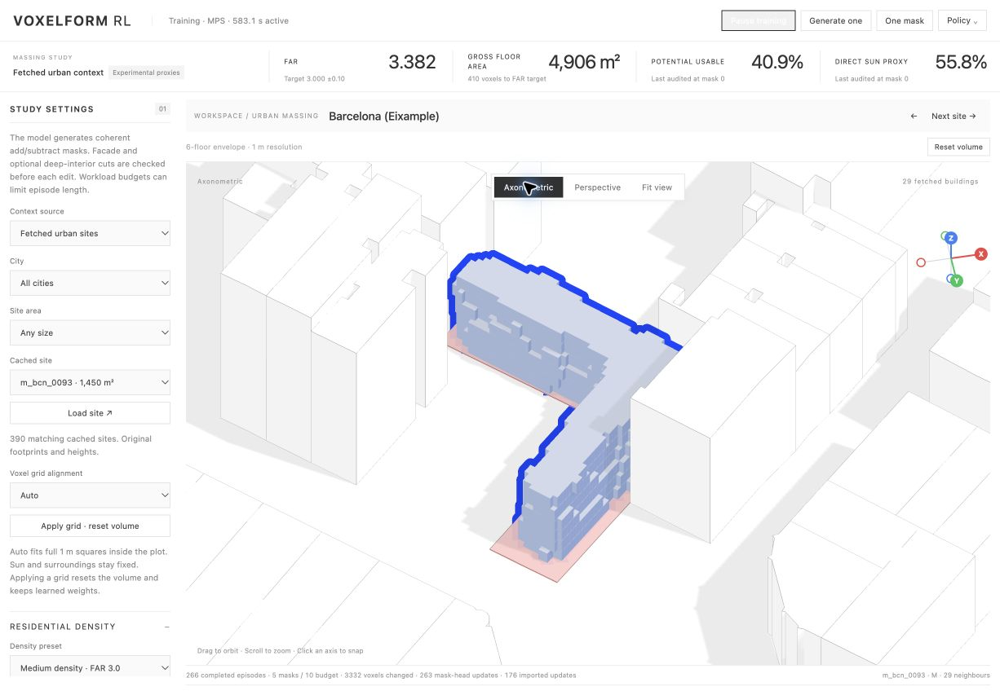

# Thick blue silhouette — 2026-11-10

User corrected the earlier request: silhouette, not crease contours. The solid
display now uses approximately 8-pixel outward saturated blue (#1645ff) LineSegments2 strokes. These
are camera-facing surface silhouettes, depth-occluded by the mass and opaque
surroundings, not an outline of every surface step. Holes and disjoint masses
can have their own visible profiles. A GPU mask of the projected whole mass discards all stroke fragments inside
the building projection, removing internal occlusion contours as well. The 16-pixel
centred line becomes an approximately 8-pixel outward stroke.

Occupancy produces collinear boundary segments plus two incident face directions.
Runs split when the facing pair changes. The GPU keeps segments whose face-facing
dot products have opposite signs; same-facing creases are discarded. Orthographic
uses a constant view direction; perspective uses direction toward the eye.
Normals rotate back into world space with the grid. Concave pairs can invert
both normals without changing the product. Geometry rebuilds on state revision;
camera motion changes shader inputs and refreshes one cached mass-only mask.
The mask target is reused and only re-rendered on geometry, camera or size changes;
there is no CPU projection/union and no all-scene postprocessing. Nested rendering
restores render target, clear colour, clear alpha and autoClear. The shared renderer
source remains unchanged.

Thick lines use Three's bundled LineSegmentsGeometry/LineMaterial. Its bundled
version requires explicit resolution updates, supplied via renderer.getSize in
the line's onBeforeRender callback. This keeps the screen width stable with zoom
and resizing. The first browser pass exposed a missing-resolution issue; corrected
before delivery. Evaluation overlays hide the silhouette.

10 Node tests pass: independent exposed-face agreement for 60 seeded random
fields, and a solid cuboid retaining six silhouette segments from its 12 creases
for three oblique view directions. JS syntax and whitespace checks pass. Browser verified the projected mass mask
removes interior strokes, keeps the thick blue outer profile, and works while
orbiting and switching between axonometric and perspective views. No console
errors were observed.
Rebuilding edge geometry for a captured 7278-cell, 6×56×58 mass measured median
3.50 ms / p95 8.35 ms over 20 warmed Node samples, 507 segments and 36504 bytes
before compacting normal attributes for instancing. This excludes GPU upload,
coordinate conversion and rendering; it is not frame-rate evidence.
Raw data: `results/silhouette-2026-11-10.json`.

The user continued training during this display change. No training pause/reset,
policy import, backend restart or geometry edit was performed by the agent.

