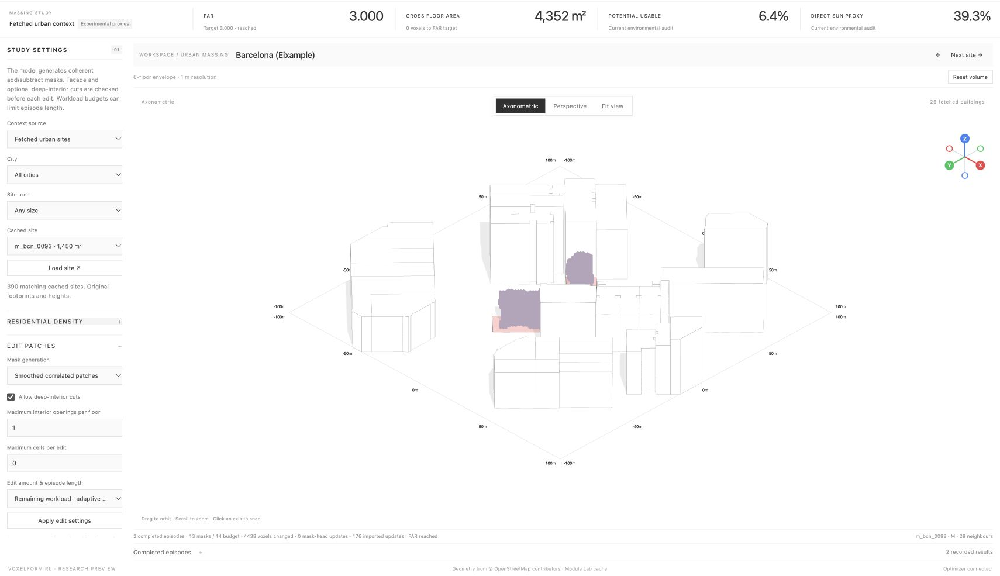
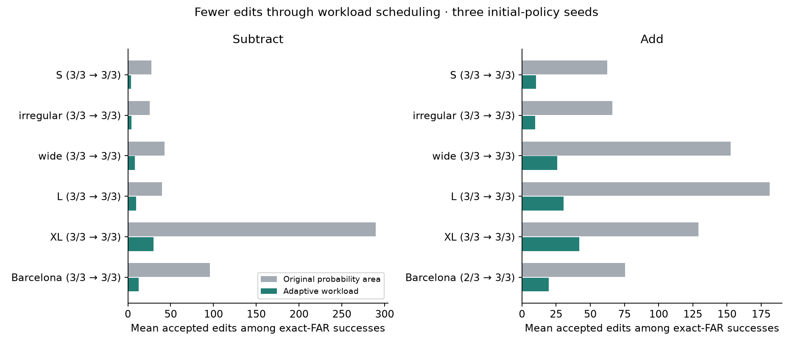

# Workload-based edits and episode budgets — 2026-11-09

Implemented and selected in the [local preview](http://127.0.0.1:8011/).
The saved Barcelona spatial model now reaches the same exact target in **13
masks rather than the previous 97**, with a fixed **14-step budget**. It changes
the same 4,438 voxels of gross floor area and ends at 4,352 occupied cells,
FAR 3.0003447087 (target 3.0 on a 1,450.5 m² parcel). Independent replay verifies
every frozen eligibility mask, topology, maximum patch count and final occupancy.
All spatial weights are exactly preserved. This is a scheduling improvement,
not evidence of learning or architectural quality improvement.

The live episode used about **1.25 seconds of additional active time**; the header
shows 5.1 seconds cumulatively, including the previous run. It remains paused.
The preview server uses native MPS sampling and same-floor depth, with the
existing compiled CPU geometry guards. Source checkpoints and the earlier mass
are preserved under `results/checkpoints/workload-before-2026-11-09/`.



## Selected approach

The neural model still generates the spatial mask directly. An adaptive controller
sets its requested area from remaining work and observed pruning losses. There
is no geometric mask library or mask-quality ranking stage.

At the episode start:

- M = absolute difference between current and target occupied cell counts.
- N = current lateral-facade voxel count for subtraction, or current eligible
  facade-growth count for addition. Deep-interior permission does not inflate N:
  those voxels are not all simultaneously usable as a coherent courtyard.
- Productive steps P = ceil(M / (0.5 × N)). An explicit per-edit cap, when set,
  also limits the denominator. Zero work succeeds immediately.
- Fixed deadline B = P + 2 + ceil(0.2 × P).

Half-capacity utilization and the reserve are conservative research settings,
chosen after the smaller deadlines repeatedly missed exact FAR. The estimate is
not a mathematical lower bound or a guarantee of reachability. The deadline
never extends during an episode. Large additions can require more steps because
growth initially starts from a narrow facade edge; there is no fixed 15-step cap.

On each accepted edit, the controller updates an EMA of applied/generated volume,
starting at .65. It requests `remaining_work / remaining_productive_steps`, divided
by that retained fraction. The sampled coherent neural field ranks which eligible
cells to change. Count is clipped to remaining FAR work, frozen eligibility and
any explicit edit cap. After a rejected draw, subsequent fresh sampled fields
can request smaller counts. All retries use the same network forward pass;
the existing one-draw / conditional-seven-draw GPU path remains.

Topology/opening projection can only discard selected bits. It never creates a
connecting path or exposes another facade layer inside the action. Ordinary
patches still have at least four cells and at most four regions. The adaptive
variant permits smaller patches for the last 16 cells, retaining the four-region,
grounding, solid connectivity and courtyard area/air-connection safeguards.

## Rewards, alternatives and checkpoint behavior

Workload episodes receive normalized FAR progress, a small per-action cost, a
success reward, and a continuous remaining-error penalty on failure. Deadline
exhaustion is `step_budget_exhausted`, not success; failed mask generation also
receives the remaining-error penalty. Environmental-audit rewards remain in the
live session. Terminal rollouts have zero bootstrap; nonterminal optimizer
rollouts continue the same mass and fixed deadline.

The UI exposes:

1. **Remaining workload · adaptive amount** — selected feedback approach.
2. **Probability area · original control** — original expected-area decoder.
3. **Remaining workload · fixed amount · experiment** — quota without feedback.
4. **Remaining workload · learned amount · experiment** — neural log-normal
   amount multiplier around the quota, with remaining work, countdown, current
   capacity, quota and operation as five additional global conditioning values.

The learned variant conditions the spatial head and critic and adds a two-output
amount head plus per-operation Gaussian scale. The sampled scalar's log
probability is included for each consumed retry, alongside the spatial latent
score. Tests demonstrate amount-head gradients, weight changes and resume.
Short training improved some completion rates but did not make it reliable
enough to replace feedback scheduling.

`voxelform.patch.v1` retains backward compatibility through optional configuration
fields. Changing allocator preserves compatible spatial weights and resets
incompatible optimizer semantics. Coupled autosaves preserve the fixed deadline,
its origin, utilization estimate, mass, settings and optimizer. Existing saved
sessions retain their prior allocator; fresh sessions default to adaptive amounts.

## Experiments and limitations

See [measurements](MEASUREMENTS.md), [hypotheses and amendments](PLAN.md) and the
raw `results/workload-*.json` files. The main ablation contains 288 evaluation
episodes: four configurations, initial/short-trained weights, three seeds, six
scenes and both operations. Training uses at least 768 actions per configuration
and seed; exact counts are retained. Scene setup is reused after a documented
resumption, without deleting or relabeling existing measurements.

The selected adaptive variant reached exact FAR in **36/36 CPU calibration
checks**, **12/12 checks on a fourth CPU seed**, and **35/36 actual MPS checks**.
The MPS failure was seed 456, L addition: masks were rejected after 30 actions
with 248/3,072 voxels still needed, despite a 36-step budget. A deadline cannot
solve every spatial-policy/topology failure. It remains recorded as a failure.

Small subtraction cases took 3–4 actions, Barcelona 12–13, and CPU XL subtraction
30. CPU XL addition took 42; growth eligibility initially exposes only a narrow
edge. These are measured cases, not universal site-size presets.

Failed earlier hypotheses are retained: removing the cap alone barely helped
outside XL; counting every deep-eligible cell made deadlines too optimistic;
plain quotas lost excessive volume to projection; two reserve steps left small
unfinished tails. Four reserve steps still missed XL completion, and widening
the final-patch exception to 64 cells did not solve that. The selected version
uses the narrower 16-cell exception and a workload-scaled reserve.

These studies establish fewer edits and trainability, not convergence or better
buildings. Proxy-quality comparisons are only at matched completed FAR, with
failures excluded from quality comparisons but retained in success rates.
Calibrating reserve settings on these cases limits generalization claims. The
fourth seed tests sampling robustness, not a new architectural distribution.
Timing rows include concurrent test activity and must not be used as isolated
CPU-versus-GPU speed benchmarks. Larger masks increase ranking work; depth and
physics remain on the selected device, geometry guards remain on CPU.



## Verification and reproduction

94 Python tests pass, including actual MPS backward execution without fallback;
four viewer adapter tests pass. JavaScript syntax and whitespace checks pass.
The live replay verifies all 13 masks, unchanged weights and exact agreement
with the independent CPU planar-depth reference (maximum error 0.0).

```sh
PYTORCH_ENABLE_MPS_FALLBACK=0 python -m unittest discover -s tests -p 'test*.py'
python -m tools.workload_budget --train-actions 768
python -m tools.workload_feedback --reserve .2 --tag=-reserve
PYTORCH_ENABLE_MPS_FALLBACK=0 python -m tools.workload_feedback --device mps --reserve .2 --tag=-reserve
python -m tools.workload_feedback --reserve .2 --seeds 999 --tag=-heldout
python -m tools.report_workload
```

Historical pilot JSONs correspond to their recorded source versions; the current
command produces current-code results. `source-main/`, `source-final/`, source
hashes, raw failures and the live before/after/replay snapshots preserve evidence.
No files in Module Lab were changed. No commit or push was made.
